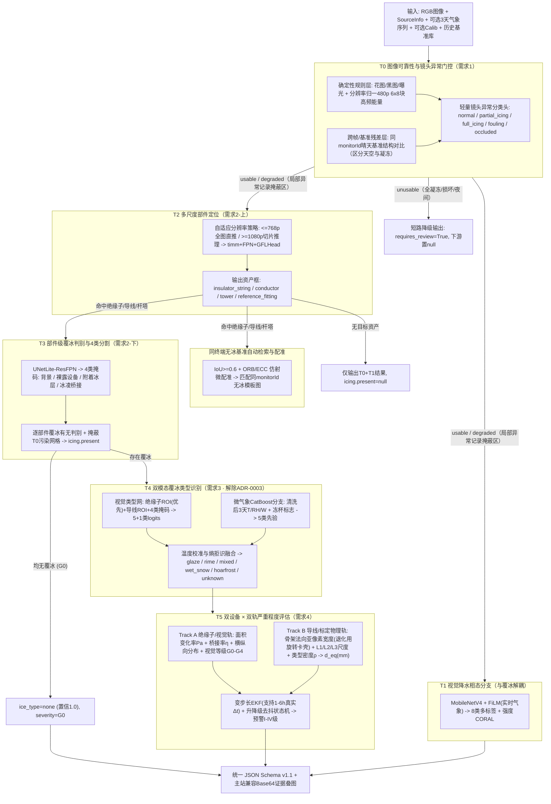

# 基于图像与微气象的电网覆冰、镜头异常及严重程度智能识别（v2.0 实施计划）

> **编制基线**：`docs/任务二 技术报告-基于机器学习的覆冰程度智能识别（电子）.docx`（1,704 段 / 395 图表）、`NW_data/华南理工 整理覆冰图像库-from梁苇和陈思睿`（7,296 张实测图 + 7,297 行 44 列气象与多标签 CSV）、既有代码库 `grid-ice-vision/`（v0.1.0，分支 `feat/v2-scut-upgrade`）与 `IMPLEMENTATION_PLAN.md`（v1.0）。  
> **Git 基线**：工作区根仓（`main` 分支，管理文档/计划/脚本，已通过 3 个分步 commit 固化 v1.0 基线）与 `grid-ice-vision/` 独立代码仓（`feat/v2-scut-upgrade` 分支，基于 `master` `18d9110`）双轨协同，所有后续研发严格执行「每步先建分支、小粒度原子化 `git commit`」。

---

## 1. 项目概述与目标

### 1.1 背景与核心痛点

2026 年 10 月完成的 `grid-ice-vision` v0.1.0 已跑通「Pydantic 契约 + 天气分类（WEAPD Macro-F1 = 0.891）+ 部件检测冒烟（TTPLA mAP@0.5 = 0.324）+ 亚像素几何量算（合成圆筒宽度误差 0.155 px）+ EKF/预警状态机」工程底座，但彼时处于**真实覆冰数据为零**的状态，导致覆冰类型头按 `ADR-0003` 强制冻结、`d_eq_mm` 恒定回退 `900 kg/m³` 或 `null`、绝缘子面积变化率与镜头凝冻识别均未接入现场域验证。

随着**任务二技术报告**与**华南理工整理覆冰图像库（SCUT，2014–2018 年南网 24 个局/超高压单位、382 个监控终端 `monitorId`、429 基杆塔共 7,296 张实测图像 + 44 列多标签与 3 天微气象 CSV）**到位，项目迎来从「合成/公开集方法验证」迈向「真实电网图像与气象多模态识别」的关键转折，同时也暴露出 4 项必须在架构阶段正面解决的现实偏差：

1. **图像分辨率与旧假设不符**：SCUT 7,296 张实测图中 **93.2% 为低分辨率图像**（`640×480` 占 5,446 张、`704×576` 占 1,142 张、`320×240` 占 206 张、`352×288` 占 6 张），仅 25 张为 `1920×1080`；既有方案假定的「`≥1080P` 且导线宽 `≥8 px`」仅覆盖少数终端，必须同时支持低清图导线与以**绝缘子串**为主体表征覆冰类型及面积变化率 `Pa` 的技术报告路线。
2. **镜头凝冻/积污样本在 SCUT 子集中已被预筛除**：技术报告 §2.6.3 指出原始 23.6 万张归档库中存在 `被遮挡 24,793`、`积污 21,502`、`局部凝冻 25,152`、`全部凝冻 35,651` 与 `无覆冰 137,148`，但本次交付的 7,296 张 SCUT CSV 中 `Frozen` 与 `Normal` 字段 100% 为 `'正常'`，`Cleanness='有污秽'` 的 93 张经实图抽查实为**绝缘子表面积污**而非镜头污染；且仅 18 张图像同时标注绝缘子与导线 `'无覆冰'`（抽查 `2015/1ff9d77ab7f546ffba015a582a95082c.jpg` 仍存在明显雾凇覆冰，属标注噪声）。
3. **覆冰类型缺失「白霜」且微气象存在传感器冻死噪声**：SCUT CSV 的 `Ice_Type` 仅含 `雾凇`（3,247）、`雨凇`（1,525）、`湿雪`（1,506）、`混合凇`（1,019）四类，不含「白霜」（仅 WEAPD 含 `frost` 475 张）；同时 `Today_Avg_Windspeed` 有 2,854 条为 `0`（技术报告 §5.3.3 明确为低温风杯冻住故障），若直接作数值特征会误导模型。
4. **工程可移植性缺陷已实测复现**：将旧工作区跨盘搬迁后，`grid-ice-vision/.venv` 内 `_editable_impl_grid_ice_vision.pth` 仍硬编码旧盘符与旧父目录名，导致 `.venv` 解释器启动直接报 `0xfffffffe`；仓库尚缺 `paths.py`、`preflight.py` 与位置无关静态门禁测试。

### 1.2 目标用户与业务场景

| 维度 | 定义 |
|---|---|
| **目标用户** | 省级/地市供电局防冰值班员、输电运检中心算法运维工程师、南网覆冰在线监测预警主站系统 |
| **调用形态** | 单帧实时回调接口（适配南网/贵州主站 `uuid + base64 + JSON` 协议与 `FastAPI` REST 接口）与历史序列批处理评估 CLI |
| **输入契约** | `RGB 图像 (320×240 至 4K)` + `SourceInfo(site_id, camera_id/monitorId, asset_id, timestamp_tz, ptz)` + 可选 `WeatherSensor(连续 3 天 T/RH/W + 传感质量位)` + 可选 `CalibInput(D0_mm, d_ref_mm, w_ref_px, w0_px, design_ice_mm)` + 可选同终端历史无冰基准图 |
| **四大核心判定输出** | ① **T0 图像与镜头可靠性**：判别正常 / 镜头局部凝冻 / 全部凝冻 / 镜头积污 / 遮挡 / 花图黑图；② **T2/T3 覆冰有无识别**：按绝缘子、导线、杆塔逐部件判定是否覆冰并输出 4 类掩码；③ **T4 覆冰类型识别**：输出雨凇、混合凇、雾凇、湿雪、白霜、无覆冰、未知 7 态概率与密度依据；④ **T5 覆冰严重程度**：双轨输出「无标定：覆盖率 + 绝缘子面积变化率 `Pa` + 桥接率 `η_bridge` + 横/纵向偏冰分布 + 视觉等级 `G0–G4`；有标定：亚像素物理厚度 `d_radial/d_eq(mm)` + 载荷比 `γ` + EKF 平滑与 `I–IV` 级预警」 |

### 1.3 量化成功标准（三栏制口径）

> 遵循 `AGENTS.md` §3：**硬门槛**为里程碑放行底线；**软目标**为工程优化方向；技术报告/文献值仅作同口径参照，**不得直接充当跨现场承诺**。

| 能力域 | 指标名称 | 硬门槛 | 软目标 | 评估数据集与口径 | 目标阶段 |
|---|---|---|---|---|---|
| **T0 镜头异常门控** | 异常帧识别 Recall / 正常帧误拦截 FPR | Recall ≥ 0.90；FPR ≤ 5% | Recall ≥ 0.95；FPR ≤ 2% | 合成凝冻/积污/花图测试集 + SCUT 正常帧回归集（现场负样本到库后复测） | M1 / M2 |
| **T2/T3 部件与覆冰有无** | 部件 ROI mAP@0.5 / 覆冰有无 Recall | ROI mAP@0.5 ≥ 0.72；覆冰有无 Recall ≥ 0.90 | ROI mAP@0.5 ≥ 0.85；覆冰有无 Recall ≥ 0.95 | SCUT 预标复核集（Monitor-Holdout 15% 终端留出，绝无同机位背景泄漏） | M2 |
| **T3 语义分割** | 绝缘子/导线掩码 Dice（含 `exposed_asset`） | Dice ≥ 0.75（合成）；≥ 0.70（SCUT 人工复核子集） | Dice ≥ 0.85（合成）；≥ 0.80（SCUT 复核子集） | 升级版合成集（含 640×480 降采样域）+ SCUT SAM2 精修子集 | M2 |
| **T4 覆冰类型（4+1 类）** | SCUT 4 类 Macro-F1 / 关键混淆 `glaze↔rime` / 校准 ECE | Macro-F1 ≥ 0.80（Monitor-Holdout）；`glaze↔rime` ≤ 15%；ECE ≤ 0.12 | Macro-F1 ≥ 0.88（视觉+微气象融合）；`glaze↔rime` ≤ 8%；ECE ≤ 0.08 | SCUT 7,296 跨终端留出测试集（视觉独立报告 + 视觉+微气象融合报告） | M2 |
| **T4 白霜（Hoarfrost）** | 白霜辅助检出 F1（WEAPD/合成） | WEAPD `frost` vs 覆冰类 F1 ≥ 0.78 | 现场白霜样本 ≥ 50 后实测 F1 ≥ 0.75 | 初期基于 WEAPD `frost`(475) + 合成 + 气象先验验证，**未获现场白霜前不宣称生产精度** | M2 / M4 |
| **T5 严重程度（双轨）** | 面积变化率 `Pa` 相关性 / 宽度误差 / 分布 QWK | 合成厚度 MAPE ≤ 12%（gt ≥ 3 mm）；宽度误差 ≤ 0.5 px；分布状态准确率 ≥ 0.80 | 合成厚度 MAPE ≤ 8%；宽度误差 ≤ 0.25 px；与力学拉力/称重相关系数 `r ≥ 0.80` | 合成真值集 + SCUT `InsulatorShapeH/V` + 同终端基准图对比子集 | M3 |
| **系统性能与稳定性** | 单帧推理 P95 时延 / 迁移可复现性 | CPU(640×480) ≤ 180 ms；GPU(1080P) ≤ 100 ms；跨盘迁移回归 100% 一致 | CPU(640×480) ≤ 120 ms；GPU(1080P) ≤ 60 ms | 1,000 帧连续压测无异常、无 OOM；异盘复制后 `preflight` + `pytest` 全绿 | M3 |
| **业务价值指标** | 镜头异常无效告警拦截率 / 人工复核减负率 | 坏图下发率 ≤ 2%；人工需复核帧比例较无门控下降 ≥ 60% | 坏图下发率 ≤ 0.5%；人工复核量下降 ≥ 75% | 模拟主站灰度回放流（含合成凝冻/污秽干扰帧） | M3 / M4 |

### 1.4 范围外声明（Scope Boundaries）

1. **不替代气象台预报冻雨**：单张图像仅能给出视觉覆冰证据与降水相态概率，是否发生气象学意义上的冻雨必须结合气象实况/探空或融化层判定。
2. **无标定不输出伪精确毫米值**：缺失 `D0_mm` 与 L1/L2 尺度参考时，`measurement_status` 严格锁定为 `not_calibrated` 或 `visual_only`，`d_eq_mm` 与 `alarm_level` 强制为 `null`（由 Pydantic 校验锁死）。
3. **无真实镜头凝冻/积污原图库前，不宣称现场镜头异常生产精度**：先基于多尺度质量特征 + 合成凝冻/泥污退化 + WoodScape 污秽先验落地能力；真实未清洗的 23.6 万池中异常帧入库后方可用于校准与验收。
4. **未获现场「白霜」标注样本（≥50 张）前，白霜不参与密闭降密度折算**：若触发白霜规则或高不确定性，`requires_review` 置 `true` 且默认保守密度不低于 `600/900 kg/m³`，防止低估隐患。
5. **不直接在主业务链路引入 GPL/AGPL 依赖**：`ultralytics`、`uricamic/soiling`（GPL-3.0）等严禁进入推理镜像；仅限 `scripts/` 离线辅助预标注或参考论文思想重写。

### 1.5 假设与前置约束

- **数据现状**：已有 SCUT 7,296 张实测图 + 44 列 CSV（含 `monitorId` 与 3 天微气象）、WEAPD 6,877 张（CC0-1.0）、TTPLA 1,242 张（Apache-2.0）、8 张零误差合成图；**缺** SCUT 逐像素掩码与 bbox（需离线 SAM 2 + 人工复核补建）、**缺** 真实 `D0_mm` 导线外径台账与拉力 `Fm` 匹配表（需业务方补充，缺失时走 Track A 视觉评估）。
- **算力与环境**：本地开发机为 Windows CPU 环境（`uv 0.11.x` + Python `3.12`），预训练与推理验证在 CPU 可跑通小批量；大规模检测/分割全量训练在 GPU 节点执行，配置兼容 `device: cpu | cuda`。
- **交付与合规**：电网图像含杆塔名称/线路号（部分图片左上角带红色 OSD 如 `2014-12-12 16:09:11 [大西I回-045#]`）及经纬度；全流程须保持内网脱敏存储，代码与权重严格遵循 Apache-2.0 / MIT / BSD / CC0 商用合规链。

---

## 2. 开源调研与借鉴方案

### 2.1 检索矩阵

> 检索执行日期：`2026-11-25 UTC`，渠道覆盖 GitHub REST API、Hugging Face 模型/数据集库及 arXiv。

| 检索轴组合（中英文关键词） | 检索渠道 | 命中量级 | 筛选结论 |
|---|---|---|---|
| `"image quality" OR "dirty lens" OR "soiling" woodscape cleanvision` | GitHub / arXiv | ~120 仓库 | 选中 `cleanlab/cleanvision`（Apache-2.0）做质量基线审计；借鉴 `valeoai/woodscape` 污秽分类学，淘汰 GPL-3.0 衍生库 `uricamic/soiling` |
| `"power line" "insulator" detection segmentation dataset ttpla insplad` | GitHub / HF | ~45 仓库 | 选中 `R3ab/ttpla_dataset`（Apache-2.0）作导线预训练；`andreluizbvs/InsPLAD`（CC BY-NC 3.0）仅作隔离评测，禁用商用训练 |
| `"segment anything" sam2 mask prelabeling segmentation_models` | GitHub / HF | ~300 仓库 | 选中 `facebookresearch/sam2`（Apache-2.0）做 SCUT 7,296 图离线半自动掩码预标注；`qubvel-org/segmentation_models.pytorch`（MIT）作轻量解码器参考 |
| `"pytorch image models" mobilenetv4 convnext catboost tabular weather` | GitHub / HF | >500 仓库 | 延续 `huggingface/pytorch-image-models`（Apache-2.0）统一骨干；新增 `catboost/catboost`（Apache-2.0）处理含风速冻零缺失的 3 天微气象表格式分支 |
| `"power line icing" OR "ice accretion" "DTL-IceNet" OR "PLAIR-AW" 2024..2026` | arXiv / GitHub | ~30 论文/仓库 | `PLAIR-AW` 无许可且缺合成脚本、`DTL-IceNet` 许可未标且 Zenodo 本机不可达，均不作核心依赖，仅吸收截面/物理机理思路 |

### 2.2 推荐开源资源清单（全部经 `verify_repos.py` 核验）

> 评分按 100 分制（场景匹配度 30 + 可复用性 20 + 权重/数据可得 20 + 许可友好 15 + 维护活跃度 15）；所有仓库均于 **2026-11-25 UTC** 通过 GitHub API 实测核验（`status=verified`，`archived=false`）。

| 仓库/资源（含核验状态与日期） | 角色 | 核心思路 | 可复用部分 | 优点 | 缺点/风险（含许可证） | 二次开发方式 |
|---|---|---|---|---|---|---|
| [huggingface/pytorch-image-models](https://github.com/huggingface/pytorch-image-models)<br>`verified` · 37,310★ · 2026-11-21 · **94/100** | 多任务统一视觉骨干底座 | 提供 MobileNetV4 / ConvNeXt-Nano / EdgeNeXt 等统一特征金字塔接口 | `create_model(..., features_only=True)`、ImageNet 预训练权重（经 `hf-mirror`） | 生态最全、ONNX 导出稳定、`Apache-2.0` 商用无风险 | 需配合镜像环境变量规避外网 502（已在 `common/config.py` 封装） | **直接复用**：保留现有 `features/backbone.py`，为镜头异常头与 4+1 类覆冰类型头新增多尺度特征导出 |
| [qubvel-org/segmentation_models.pytorch](https://github.com/qubvel-org/segmentation_models.pytorch)<br>`verified` · 11,817★ · 2026-11-23 · **89/100** | 覆冰分割解码器与损失库 | 解耦编码器与 UNet/FPN/SegFormer 解码器，支持 Dice/Focal/Lovasz 复合损失 | FPN/UNet++ 解码块、边界损失与 `timm` 编码器桥接接口 | `MIT` 许可友好、轻量化变体适合 512² CPU/GPU 部署 | 细导线（1–8 px）直接预测易断裂 | **混合架构**：借其 FPN+UNet 跳连解码与边缘损失改进 `features/ice/model.py`，训练用现有 `training/engine.py` 保持轻量 |
| [catboost/catboost](https://github.com/catboost/catboost)<br>`verified` · 9,216★ · 2026-11-24 · **86/100** | 3 天微气象表格式覆冰类型分支 | 基于对称决策树处理连续气象特征与缺失值（风速冻零置 NaN） | `CatBoostClassifier` 训练/概率校准/ONNX 导出 | 原生处理缺失值、抗传感器冻死异常、推理仅 <1 ms、`Apache-2.0` | 纯气象模型无法感知同一站点局部脱冰或太阳辐射差异 | **直接复用+融合**：仅输入 27 维微气象+传感器质量标志（**屏蔽经纬度防站点记忆泄漏**），输出概率与视觉头加权融合 |
| [cleanlab/cleanvision](https://github.com/cleanlab/cleanvision)<br>`verified` · 1,213★ · 2026-01-08 · **85/100** | 数据质检与低质样本审计底座 | 统一计算模糊度、暗/亮曝光、低信息熵、宽高比异常与近重复图像簇 | `Imagelab` 质量打分算子与近重复聚类逻辑 | `Apache-2.0`、零标注冷启动、可直接扫描 SCUT 7,296 张图发现坏样本 | 原生无「局部镜头结冰/积污」专类判别 | **直接复用+扩展**：离线审计 SCUT 入库清单；将信息熵与空间分块算子思路重构进纯 NumPy/OpenCV `features/quality/` |
| [facebookresearch/sam2](https://github.com/facebookresearch/sam2)<br>`verified` · 20,220★ · 2026-05-30 · **84/100** | 离线半自动掩码与 ROI 预标注引擎 | 提示驱动（点/框）高精度分割与视频跨帧传播（同 `monitorId` 时序传播） | `SAM2ImagePredictor` 与 `SAM2VideoPredictor`（同机位连续帧传播） | 对复杂背景下的玻璃/瓷绝缘子伞裙及冰凌边缘贴合极佳、`Apache-2.0` | 推理显存与耗时高，不适合直接跑实时监控推理 | **蒸馏/预标注替代**：仅入 `scripts/prelabel_scut.py` 离线为 1,500 张 SCUT 图生成 4 类掩码初稿，人工复核后训轻量 `UNetLite` |
| [R3ab/ttpla_dataset](https://github.com/R3ab/ttpla_dataset)<br>`verified` · 205★ · 2023-01-07 · **80/100** | 导线与杆塔检测预训练底座 | 航拍 4K 输电走廊精细多边形标注及转换脚本 | `labelme` 转 COCO 管线、导线/杆塔预训练权重 | `Apache-2.0` 明确、含 10,102 根导线实例，本机已有全量缓存 | 航拍俯视域与杆塔侧视域差大、缺绝缘子串类 | **直接复用**：保留作导线/杆塔基础预训练权重，混合 SCUT 预标注集做跨域微调 |
| [valeoai/woodscape](https://github.com/valeoai/woodscape)<br>`verified` · 727★ · 2023-08-26 · **75/100** | 镜头积污/水雾分类学与合成参考 | 定义 `clean / transparent_soiling / opaque_soiling` 镜头污染等级与区域块标注范式 | 镜头脏污空间块定义、半透明/不透明污秽物理成因建模 | 工业界唯一成体系的镜头污染视觉基准 | GitHub 仓库未标 SPDX 许可（数据集受研究许可约束） | **仅借思路**：按其透明/不透明双模态退化原理自研镜头凝冻与积污合成算子，不直接引入其数据与第三方 GPL 代码 |
| [andreluizbvs/InsPLAD](https://github.com/andreluizbvs/InsPLAD)<br>`verified` · 185★ · 2026-08-04 · **70/100（商用受限）** | 绝缘子与刚性金具研究对照基准 | 10,607 张无人机巡检图覆盖 17 类电力部件（含绝缘子、防振锤、间隔棒） | 绝缘子与刚性金具 bbox 评估口径、难度分层对照 | 部件类别与 L1 刚性金具标定需求高度契合 | 许可为 **CC BY-NC 3.0**（禁止商用） | **隔离研究对照**：只进 `data/external/` 评估微调模型在绝缘子/金具上的泛化上界，**严禁进入商用交付权重训练** |

### 2.3 组合拼装结论与未采用项

- **组合拼装方案**：以 `grid-ice-vision` 现有 **「`timm` 骨干 + 自建 GFL 检测头 + `UNetLite` 分割 + 纯函数亚像素几何与物理量算」** 为无 AGPL/GPL 传染的生产主干；引入 **`cleanvision`** 做 SCUT 数据审计并强化 T0 镜头凝冻/积污门控；离线以 **`sam2`** 协同技术报告的 GrabCut-PRO 思路为 SCUT 图像快速补建掩码与检测框；引入 **`catboost`**（3 天微气象分支）与 `IceTypeVisualNet` 解除 `ADR-0003` 冻结，实现 4+1 类覆冰类型高精度识别与密度折算；保留 **`ttpla_dataset`** 预训练底座与 **`InsPLAD`** 隔离评测对照。
- **明确未采用项及理由**：
  1. **Ultralytics YOLOv5 / YOLOv8（技术报告第 3 章路线）**：实测 `AGPL-3.0` / `GPL-3.0` 传染协议对电网企业私有化交付存在法务红线；继续严格限定仅允许在离线 `scripts/prelabel.py` 使用，生产链路以 `timm + FPN + GFLHead` 替代。
  2. **Detectron2 Mask R-CNN（技术报告第 6 章路线）**：依赖较重（在 Windows CPU/轻量边缘节点编译与 ONNX 导出复杂）且 `ResNet50-FPN` 单帧推理耗时偏高；改用 `timm` + 轻量 `UNetLite`（保留技术报告中连通域滤波、凸包/旋转卡壳逻辑作为亚像素骨架法向测量的互补降级检查）。
  3. **纯 3 天微气象 KNN（技术报告第 5 章路线）**：虽然在 SCUT 取得 86.7% 精确率，但单模态在「同终端短期融冰/过渡态」及「风速传感冻零」场景失效明显（表 5-8 错判 170 例），故升级为 **视觉特征为主 + `CatBoost` 微气象软融合**（气象缺测时无缝退化为纯视觉）。
  4. **WoodScape 衍生代码 `uricamic/soiling`**：实测标为 `GPL-3.0` 且自 2019 年起未维护，仅借鉴论文透明/不透明污秽建模思路，不复用其代码。

---

## 3. 系统架构与算法设计

### 3.1 统一 I/O 契约表（Schema v1.1 向后兼容扩展）

> 继承 `common/schemas.py` v1.0 的全部约束（新增字段均提供默认值，严格保持 `measurement_status` 三态门控与天气/覆冰物理隔离原则）。

| 方向 | 字段/对象 | 模态与格式 | 尺寸/范围约束 | 取值/语义说明 |
|---|---|---|---|---|
| **输入** | `image` | RGB 图像（JPEG/PNG/BGR 数组） | 短边 `240–2160 px`（主战场 `640×480` 与 `1920×1080`） | 固定监控或无人机画面；自动记录原始宽高并归一化采样尺度 |
| **输入** | `source` | `SourceInfo` JSON | `site_id, camera_id, timestamp(带时区), ptz{zoom,pan,tilt}` | 新增 `monitor_id` 与 `baseline_image_ref`（可选，用于同机位 `Pa` 对比） |
| **输入** | `weather_seq` | 可选 3 天气象序列（兼容单帧 `weather_sensor`） | `d-2, d-1, d0` 的 `T(Avg/Max/Min)`, `RH`, `W` | 新增传感器冻死哨兵检测位：`wind_frozen_flag`, `rh_invalid_flag`（`0` 值不直接当真实零风速/零湿度） |
| **输入** | `calib` | `CalibInput` JSON | `d0_mm, d_ref_mm, w_ref_px, w0_px, design_ice_mm` | 任一字段缺失均允许运行，自动决定 `measurement_status` |
| **输出** | `quality` | `QualityInfo` | `status ∈ {usable, degraded, unusable}`；`reliability_score ∈ [0,1]` | 新增 `lens_status ∈ {normal, partial_icing, full_icing, fouling, occluded, corrupted}`、`affected_grid_ratio`、`lens_conf` |
| **输出** | `precipitation` | `PrecipResult` | 8 类多标签概率 `[0,1]` + `intensity` | 与覆冰结论物理隔离，支持 `unknown` 拒识 |
| **输出** | `assets[]` | `list[Asset]` | `cls ∈ {conductor, insulator_string, tower, reference_fitting}` | 每部件新增 `icing_present: bool\|None`、`icing_conf: float`、`roi_quality_masked: bool` |
| **输出** | `icing` | `IcingResult` | `present: bool\|None`、`ice_type`（7 态）、`coverage_ratio`、`bridge_ratio` | `ice_type ∈ {none, glaze, rime, mixed, wet_snow, hoarfrost, unknown}`；新增 `ice_type_probs` 与 `baseline_matched_iou` |
| **输出** | `severity` | `SeverityResult` | `visual_grade(G0–G4)`、`insulator_pa_pct`、`eccentricity_h`、`d_eq_mm`、`alarm_level(I–IV)` | **Track A（永远可用）**：`visual_grade`, `insulator_pa_pct`, `insulator_dist_v/h`；**Track B（需标定）**：`d_radial_mm`, `d_eq_mm`, `gamma`, `alarm_level` |
| **输出** | `evidence` | `dict[str, str]` | 相对路径或 Base64 JSON（主站适配模式） | 包含质量网格热图、部件检测框、4 类分割叠图、卡尺/基准对比叠图 |

### 3.2 评测指标体系

| 类别 | 指标 | 计算口径与物理意义 | 关注重点 |
|---|---|---|---|
| **主指标** | 镜头异常 Recall@FPR≤5% | `TP_bad / (TP_bad + FN_bad)` | 防止将「全凝冻/严重积污」图误放行给下游误报覆冰 |
| **主指标** | 部件级覆冰有无 Macro-F1 / Recall | 绝缘子/导线各自 `是否覆冰` F1 与高危漏检率 | 确保不漏掉局部覆冰或导线单独覆冰 |
| **主指标** | 覆冰类型 4+1 类 Macro-F1 & ECE | 按 `Monitor-Holdout` 留出测试集逐类平均 F1 与期望校准误差 | 重点监控 `glaze ↔ rime` 与 `rime ↔ mixed` 边界 |
| **主指标** | 严重程度双指标（`Pa` MAE / 厚度 `MAPE` / 等级 `QWK`） | `Pa` 相对误差；`gt ≥ 3 mm` 样本厚度 `MAPE`；G0–G4 二次加权 Kappa | 0 厚度样本独立统计假阳性，不混入 MAPE 分母 |
| **业务指标** | 坏图告警拦截率 & 人工复核率 | 经 T0 拦截后未进入调度员工作台的无效/误报比 | 直接决定一线运维人员对系统的信任度 |
| **性能指标** | 端到端 P95 时延 & 峰值内存/显存 | `640×480`（SCUT 主分辨率）单帧与 `1080P` 切片含前后处理总耗时 | 满足边缘端与主站并发吞吐预算 |

### 3.3 系统总体架构与数据流



### 3.4 关键模块算法选型对比与取舍

#### 3.4.1 镜头凝冻/积污检测（需求 1）

| 候选方案 | 精度（公开/合成参考） | CPU 单帧时延 | 显存 | 数据需求 | 可部署性 | 选型结论 |
|---|---|---|---|---|---|---|
| 纯统计阈值（既有 `gate.py` `block_highfreq`） | 对整帧模糊有效，对「局部凝冻/积污」漏检高，且跨分辨率未归一 | `< 3 ms` | 0 | 无需训练（需每分辨率校准） | 极高 | **保留作 T0-A 前置快筛**（增加 480p 短边归一化与行差花图算子） |
| 双图基准残差 + 轻量 CNN（`MobileNetV4-Small` 多头） | 可同时区分「天空平坦」与「局部凝冻/积污/遮挡」 | `~12 ms` | `< 150 MB` | 合成退化 3,000+ 张 + SCUT 7,296 正常图 + 后续现场负样本 | 高（ONNX 纯卷积） | **主选**：规则快筛 + 同机位结构残差 + 轻量 5 类镜头状态头 |
| 语义分割污秽掩码（WoodScape `SoilingNet` 思路） | 可像素级标出污斑区域（参考 mIoU ~0.82） | `~45 ms` | `~400 MB` | 需像素级镜头污秽掩码（当前 0 标注） | 中 | **延后至 M4**：当前用 `6×8` 网格注意力热图定位异常区域即可，零像素标注成本 |

#### 3.4.2 部件定位、覆冰分割与有无判别（需求 2）

| 候选方案 | 精度（文献/实测） | 速度（640×480 CPU） | 数据前提 | 许可与可部署性 | 选型结论 |
|---|---|---|---|---|---|
| `YOLOv5` 检测 + `Mask R-CNN` 分割（技术报告路线） | 绝缘子 mAP 90.1%；导线 P 97.2% / R 73.7% | `> 200 ms`（双大网络） | 需人工全标框+掩码 | YOLOv5 `GPL-3.0` 商用风险高 | **不作生产架构**，仅对比验证 |
| `timm + FPN + GFLHead`（检测）+ `UNetLite-ResFPN`（分割） | TTPLA 冒烟 0.324；升级后目标 `mAP≥0.72` / `Dice≥0.75` | `~65–110 ms` | TTPLA(1,242) + SAM2 预标复核 SCUT(1,500) + SCUT 部件有无标签(7,296) | `Apache-2.0 / MIT` 全合规 | **主选生产链路**：规避 AGPL，低清 `≤768p` 图免切片一次前向，降低 4× 时延 |
| 端到端全图 `RT-DETR` / `SAM2` 直接部署 | 通用零样本精度高 | `> 800 ms`（CPU 不可用） | 需 GPU（≥4GB 显存） | `Apache-2.0` | **`SAM2` 仅进离线预标注脚本**，`RT-DETR` 列为高配 GPU 节点 M4 备选 |

#### 3.4.3 覆冰类型识别（需求 3）

| 候选方案 | 精度（文献/预期） | 缺失气象鲁棒性 | 地理泄漏风险 | 选型结论 |
|---|---|---|---|---|
| 纯 3 天微气象 KNN（技术报告 Ch.5） | SCUT 同分布 `A=92.2%`, `P=86.7%`（表 5-7） | 极弱（风速传感器冻死 `Wa=0` 或无气象时直接失效） | 易受站点分布不均影响 | **不作主选**，改用 `CatBoost` 处理缺失/冻死哨兵 |
| 纯图像分类（绝缘子 ROI CNN） | 技术报告表 3-4 `mAP=90.1%`，但低清下 `雾凇↔混合凇` 混淆高 | 完全免疫气象缺测 | 低（仅学表面纹理与透明/冰凌形态） | **视觉主干**，任何场景保底可用 |
| **视觉 `IceTypeVisualNet` + 微气象 `CatBoost` 校准晚融合** | 预期 Monitor-Holdout `Macro-F1 ≥ 0.84`（优于任一单模态） | 高（内置 `met_avail` 门控与单模态退化分支） | 可控（**严禁经纬度/局号进主干特征**，仅留可选地理先验开关） | **主选**：兼顾视觉瞬时态与 3 天微气象物理累积规律，满足 `ADR-0003` 全部 7 项开闸条件 |

#### 3.4.4 覆冰严重程度计算（需求 4）

- **为什么不能只做单一导线厚度或单一覆盖率**：实测 SCUT 图像中 `ObjectType = 未包含线路` 有 632 张、`LineShapeH = 无覆冰` 有 4,410 张，而绝缘子覆冰占比极高；技术报告同时证明了「绝缘子看面积变化率 `Pa` + 桥接率 + 偏心/纵向分布，导线看亚像素像素径向增量 `ΔW` + 类型密度折算 `d_eq`」的双设备规律。
- **具体算子设计**：
  1. **绝缘子分支**：当存在同 `monitorId`（`IoU ≥ 0.6`）匹配的无冰参考帧时，计算掩码像素面积变化率 $P_a = (A_{\text{ice}} - A_{\text{nor}}) / A_{\text{nor}}$；无参考帧时直接基于单帧 4 类掩码计算有效覆冰覆盖率 $C_{\text{cov}} = (N_{\text{ice}} + N_{\text{bridge}}) / (N_{\text{exposed}} + N_{\text{ice}} + N_{\text{bridge}})$、伞裙间隙桥接率 $\eta_{\text{bridge}}$（修复 `pipeline.py:349` 硬编码 `bridge=None` 缺陷），并联合监督头输出纵向分段（`上/中/下/全部`）与横向偏心度（`均匀/左重/右重`），对齐 SCUT `InsulatorShapeH/V` 标注体系。
  2. **导线分支**：优先运行既有 `features/severity/geometry.py::measure_widths()`（骨架直径 BFS + 法向三点抛物线亚像素峰位 + IQR 截尾均值，克服弯曲弧垂导线外接矩形失效）；当局部过短导致骨架法截面比例 `< 0.3` 时，降级调用技术报告第 7 章的「连通域滤波 + 凸包 + 最小外接矩形短边」作辅助参考并标 `requires_review=True`。
  3. **物理折算与变步长 EKF**：使用 T4 校验通过的 `ice_type` 查表得 `rho_kg_m3`（`glaze: 900, mixed: 600, wet_snow: 350, rime: 300, hoarfrost: 200, unknown/none: 900`；置信度低于门限时强制回退 `900`），算得 `d_radial_mm` 与 `d_eq_mm`。升级 `application/temporal.py::ThicknessEKF`，根据前后帧 `Image_Time` 动态计算 `Δt`（兼容南网 1–6 小时间隔采样），消除原固定 `dt_minutes=15` 引起的增长率截断失真。

### 3.5 训练流程与推理流程

1. **分阶段训练流程**：
   - `Stage A（数据审计与预标注）`：`CleanVision` + 气象哨兵清洗 SCUT 7,296 图 → 产出 `scut_audit.json` → `SAM2` 对 1,500 张分层采样图生成检测框与 4 类掩码初稿 → 人工抽检修正 → 产出 `detect_scut_v2.jsonl` 与 `seg_scut_v2.jsonl`。
   - `Stage B（T0 镜头异常头训练）`：SCUT 正常图 + 合成凝冻/泥污/花图退化图（`1:1` 均衡）→ 训练轻量 `LensAnomalyHead` → 产出 `artifacts/quality/lens_v2/best.pt` 与分辨率归一化基线表 `quality_norm_v2.json`。
   - `Stage C（T2 检测 + T3 分割联合迭代）`：`TTPLA` 预训练权重 → 在 `detect_scut_v2 + 合成低清图` 上微调 GFL 检测头 → 裁切 ROI 混合 `合成覆冰（0误差）+ SCUT 复核掩码` 微调 `UNetLite-ResFPN` → 产出 `detector_v2/best.pt` 与 `seg_v2/best.pt`。
   - `Stage D（T4 双模态覆冰类型解冻）`：按 `Monitor-Holdout` 划分训练视觉类型分支（含 WEAPD `frost` 对白霜预热）与微气象 `CatBoost` 分支（含风速冻零 NaN 掩码）→ 验证集温度标定 + 熵拒识阈值搜索 → 逐项检查 `ADR-0003` G1–G7 门禁后解冻接线 → 产出 `ice_type_visual_v2.pt`、`ice_type_met_v2.cbm` 与 `ice_type_cal_v2.json`。
2. **在线推理流程**：接收图像与元数据 → **T0** 分辨率归一化质检与镜头异常判别（不可靠则短路返还人工复核）→ **T1** 天气相态独立预测 & **T2** 自适应尺度部件定位（平行不互锁）→ **BaselineMatcher** 同终端无冰图自动配准 → **T3** ROI 4 类分割与部件覆冰有无汇总 → **T4** 视觉+气象双模态覆冰类型与概率校准 → **T5** 绝缘子 `Pa`/桥接率/偏冰 + 导线亚像素厚度 `d_eq`/变步长 EKF/I–IV 级预警 → 渲染叠加卡尺/分割/热力对比图并输出 `InferenceResult`（兼容南网主站 `uuid + base64` 协议）。

### 3.6 部署形态与可解释性

- **部署形态（端云协同 + 主站兼容）**：提供统一 `ONNX Runtime`（CPU/GPU）加速推理核心与 `FastAPI` 微服务（保留并扩展现有 `service/api.py`），同时保留与技术报告第 8 章一致的**主站适配器 `/api/v1/csg/infer`**（支持入参图像 `uuid`、输出 `base64` 标注图与 JSON 结构化参数），兼顾边端低算力（`640×480` 单帧纯 CPU `< 180 ms`）与省/地市主站 GPU 集中批处理。
- **可解释性输出**：每份告警附带三联图证据（① T0 `6×8` 质量异常网格热图；② 部件 ROI 与 4 类覆冰分割掩码叠图 + 卡尺截面测量线；③ 同 `monitorId` 匹配无冰基准图与当前覆冰图并排对比及面积变化率 `Pa` 标注）及可追溯字段（`ice_type_source`, `rho_source`, `measurement_status`, `calibration_source`, `config_hash`），直接支持值班员 5 秒内复核真伪。

---

## 4. 详细文件夹结构

> **存量增量演进策略**：基于 `grid-ice-vision/`（`feat/v2-scut-upgrade` 分支）**只补缺、不盲目覆盖**已通过验证的契约/几何/测试文件；同时补齐原仓库缺失的**位置无关路径层（`core/paths.py`、`scripts/preflight.py`、`tests/unit/test_no_host_paths.py`、`configs/paths.example.yaml`）**与工程元文件契约。

### 4.1 顶层工作区与代码仓目录树

```text
<workspace-root>/                                  # 根 Git 仓（main 分支：管理文档、计划与数据目录契约）
├── .gitignore                                     # 排除 grid-ice-vision/、NW_data/、docs/*.docx、.workbuddy-ai/
├── IMPLEMENTATION_PLAN.md                         # v1.0 归档计划（只读留档）
├── 数据可行性需求调研报告_v1.0.md                  # v1.0 数据调研基线（只读留档）
├── 数据需求清单_v1.0.xlsx                          # 51 项数据需求台账
├── 电网覆冰智能识别_v2.0-实现计划.md               # 本文档：v2.0 可执行实施计划
├── docs/                                          # 外部参考报告（*.docx 不入 git）
├── NW_data/                                       # 外部实测原始库（只读，经 paths.py external() 解析，不入 git）
└── grid-ice-vision/                               # 独立代码 Git 仓（feat/v2-scut-upgrade 分支）
    ├── README.md                                  # 项目说明、边界声明、uv 启动与运行命令
    ├── LICENSE                                    # 商业/交付许可证声明
    ├── .gitignore                                 # 排除 .venv/、data/*、artifacts/、*.pt/onnx、paths.local.yaml
    ├── pyproject.toml                             # 唯一依赖与工具配置源（hatchling + uv + ruff + mypy + pytest）
    ├── uv.lock                                    # [NEW] uv 锁定文件（必须入库保证跨机可复现）
    ├── .python-version                            # [NEW] 锁定 Python 3.12
    ├── Makefile                                   # Linux/Git Bash 常用命令入口
    ├── justfile                                   # Windows 跨平台等价命令入口
    ├── AGENTS.md                                  # Agent 研发边界、数据红线与 commit 规范契约
    ├── .github/workflows/                         # CI（lint/typecheck/unit/portability）与回归工作流
    │   ├── ci.yml                                 # 每次 push/PR 执行 ruff + mypy + pytest -m "not slow"
    │   └── regression.yml                         # 定时/手动合成+实测留出回归门禁
    ├── configs/                                   # 所有算法阈值与数据/训练/部署配置（YAML）
    │   ├── paths.example.yaml                     # [NEW] 外部数据目录映射模板（入库，含 SCUT/TTPLA/WEAPD 键）
    │   ├── labels/                                # taxonomy.yaml（新增 hoarfrost）与 severity.yaml（新增 Pa 分档）
    │   ├── data/                                  # base.yaml / weather.yaml / icing.yaml / scut.yaml [NEW]
    │   ├── model/                                 # pipeline.yaml / quality.yaml / ice_type.yaml [NEW] / detector_gfl.yaml
    │   ├── train/                                 # lens.yaml [NEW] / precip.yaml / detector.yaml / seg.yaml / ice_type.yaml [NEW]
    │   ├── deploy/                                # onnx_cpu.yaml / trt_fp16.yaml
    │   └── rules/                                 # alarm.yaml
    ├── data/                                      # 数据根（仅 README.md、.gitkeep 与 manifests/splits 索引入库）
    │   ├── README.md                              # 数据登记台账（含 SCUT 7,296 校验哈希与缺口记录）
    │   ├── raw/                                   # 原始开源数据包（gitignore）
    │   ├── interim/                               # SAM2 预标注与 CleanVision 审计中间产物（gitignore）
    │   ├── processed/                             # 合成集与预处理裁剪/掩码（gitignore）
    │   ├── external/                              # 只读外部/非商用数据集（如 InsPLAD，gitignore）
    │   ├── manifests/                             # JSONL 数据契约清单（只存相对 POSIX 路径，不存盘符）
    │   └── splits/                                # [NEW] Monitor-Holdout 与 Temporal-Holdout 划分索引
    ├── docs/                                      # 设计文档、ADR、评测报告与模型卡
    │   ├── architecture.md                        # 系统架构（v2.0 同步更新 T0/T4/T5 链路）
    │   ├── annotation_guide.md                    # 标注规范（补充镜头凝冻/积污、绝缘子框与 SCUT 噪声规则）
    │   ├── data_license_ledger.md                 # 许可台账（新增 SAM2/CatBoost/CleanVision/SCUT 授权条）
    │   ├── decisions/                             # ADR-0001..0003 + ADR-0004(解冻覆冰类型与双轨严重度) [NEW]
    │   └── model_cards/                           # 各分支模型卡
    ├── scripts/                                   # 数据准备、预标注、校验、导出与可移植性巡检脚本
    │   ├── preflight.py                           # [NEW] 换盘/换机自检（查陈旧 .pth 与包导入来源）
    │   ├── health_check.py                        # [NEW] 存储健康、备份 SHA-256 校验与 manifest 计数自洽
    │   ├── audit_scut.py                          # [NEW] CleanVision + 气象哨兵审计 SCUT 7,296 图与 CSV
    │   ├── build_scut_manifest.py                 # [NEW] 生成 SCUT 分层划分清单（Monitor-Holdout/Temporal-Holdout）
    │   ├── prelabel_scut.py                       # [NEW] SAM2 + GrabCut-PRO 批量生成 SCUT 框/掩码初稿
    │   ├── synthesize_lens_degradation.py         # [NEW] 合成镜头局部/全凝冻、泥污、花图退化样本
    │   ├── synthesize_ice.py                      # 优化多边形批量生成速率（解决单张 9.4s 瓶颈）
    │   ├── validate_dataset.py                    # 泄漏与哈希校验入口
    │   └── export_onnx.py                         # 全分支 ONNX 导出与一致性校验
    ├── src/grid_ice_vision/                       # 核心源代码（src layout，层级 <= 4）
    │   ├── __init__.py                            # 包版本 0.2.0 与导出
    │   ├── __main__.py                            # [NEW] 支持 `python -m grid_ice_vision` 入口
    │   ├── cli.py                                 # Typer 子命令（新增 audit / calibrate / bench）
    │   ├── common/                                # 基础设施：契约、配置、路径解析、日志、常量
    │   │   ├── paths.py                           # [NEW] 位置无关解析（PROJ/external/resolve_legacy/rel_posix）
    │   │   ├── config.py                          # YAML 加载、镜像配置（改用 PROJ 定位，禁写死相对 cwd）
    │   │   ├── constants.py                       # 类别常量（扩充 7 态 IceType 与 6 态 LensStatus）
    │   │   ├── schemas.py                         # Pydantic v1.1 向后兼容契约
    │   │   └── logging.py                         # 结构化日志
    │   ├── data/                                  # 清单解析、分组划分、数据集、变换与采样
    │   │   ├── manifest.py                        # 经 paths.resolve_legacy() 兼容历史路径
    │   │   ├── splits.py                          # 支持 Monitor-Holdout 与 Season-Holdout 双切分
    │   │   ├── datasets/                          # weather.py / detection.py / segmentation.py / scut_multimodal.py [NEW]
    │   │   ├── samplers/                          # scene_stratified.py（增加分辨率与传感器缺失均衡采样）
    │   │   └── transforms/                        # common.py / weather_aug.py / ice_aug.py / lens_aug.py [NEW]
    │   ├── features/                              # 纯算法层（严禁读写文件、解析配置或打印日志）
    │   │   ├── backbone.py                        # timm 统一特征提取
    │   │   ├── quality/                           # gate.py（480p 归一与花图）+ lens_model.py [NEW] + baseline_diff.py [NEW]
    │   │   ├── precipitation/                     # model.py / prior.py / calibrate.py / infer.py
    │   │   ├── detection/                         # model.py / loss.py / infer.py（自适应切片门槛）
    │   │   ├── ice/                               # model.py / infer.py / ice_type_net.py [NEW] / met_fusion.py [NEW]
    │   │   └── severity/                          # calibration.py / geometry.py / insulator_pa.py [NEW] / grading.py / ice_type.py / thickness.py
    │   ├── training/                              # 训练引擎、损失（CORAL/QFL/Dice+Boundary/Focal）、回调
    │   ├── evaluation/                            # classification.py / detection.py / segmentation.py / thickness.py / quality_eval.py [NEW]
    │   ├── application/                           # pipeline.py（串联 T0-T5）/ baseline_matcher.py [NEW] / temporal.py / decision.py / evidence.py
    │   ├── deployment/                            # export.py / runtime.py / benchmark.py
    │   └── service/                               # api.py（含 CSG 主站 uuid+base64 适配路由）/ errors.py
    └── tests/                                     # 四级测试套件
        ├── conftest.py                            # [NEW] 共享夹具（PROJ、无盘符隔离临时目录）
        ├── unit/                                  # 含 test_no_host_paths.py [NEW] 及纯函数/形状/契约/单调性测试
        ├── integration/                           # 端到端单图管线、API 路由、ONNX 导出一致性测试
        └── e2e/                                   # 合成真值回归与 SCUT 留出回归门限校验
```

### 4.2 关键新增与改造文件职责表

| 路径 | 职责与改动点 | 首次创建/修改阶段 |
|---|---|---|
| `grid-ice-vision/src/grid_ice_vision/common/paths.py` | 实现 `PROJ`、`external()`、`resolve_legacy()`、`rel_posix()`，使工程及外部 `NW_data/` 完全脱离宿主盘符 | M0 |
| `grid-ice-vision/configs/paths.example.yaml` | 记录 `SCUT_DATASET_ROOT`、`TTPLA_ROOT` 等外部数据相对/本地映射模板，对应 `paths.local.yaml` 不入库 | M0 |
| `grid-ice-vision/scripts/preflight.py` & `health_check.py` | 检测陈旧 `.pth`、校验导入来源、核验磁盘读写与备份 SHA-256 清单自洽 | M0 |
| `grid-ice-vision/tests/unit/test_no_host_paths.py` | 静态门禁扫描 `src/`、`configs/`、`scripts/` 禁止宿主盘符字面量（允许 URL 与注释） | M0 |
| `grid-ice-vision/scripts/audit_scut.py` & `build_scut_manifest.py` | 核验 SCUT 7,296 图与 CSV 一致性（标记缺失的 `8ab1536997a848e68697cdf781c181dd`），识别冻死风速哨兵并生成双切分索引 | M0 |
| `grid-ice-vision/src/grid_ice_vision/features/quality/gate.py` & `lens_model.py` | 新增短边 480p 归一高频能量、花图扫描、同机位基准结构残差与 5 类镜头状态轻量模型 | M1 |
| `grid-ice-vision/scripts/prelabel_scut.py` & `synthesize_lens_degradation.py` | 离线用 `SAM2` 生成 SCUT 绝缘子/导线掩码初稿；生成局部/全凝冻与泥污退化合成训练样本 | M1 / M2 |
| `grid-ice-vision/src/grid_ice_vision/features/ice/ice_type_net.py` & `met_fusion.py` | 实现绝缘子+导线双 ROI 视觉类型头与 `CatBoost` 3 天微气象融合推理（含 `hoarfrost` 规则与熵拒识） | M2 |
| `grid-ice-vision/src/grid_ice_vision/features/severity/insulator_pa.py` & `application/baseline_matcher.py` | 同 `monitorId`（`IoU>=0.6` + ECC 配准）自动匹配无冰模板、计算绝缘子面积变化率 `Pa`、打通 `bridge_ratio` 与偏心分布 | M3 |
| `grid-ice-vision/src/grid_ice_vision/application/temporal.py` & `service/api.py` | `ThicknessEKF` 改为支持真实异步 `Δt`（1–6h）；API 增补主站 `uuid + base64` 协议路由 | M3 |

### 4.3 目录纪律与位置无关规范

1. **命名与层级**：包与模块统一 `snake_case`，类名 `CamelCase`，嵌套不超过 4 层；空占位目录放 `.gitkeep`，关键目录配 `README.md`。
2. **禁止噪音目录**：严禁在仓内出现 `utils/`、`misc/`、`temp/`、`test2/`、`new/`、`runs/`、`logs/`、`tmp/`、`old_code/`；所有实验产物只进 `artifacts/`（已在 `.gitignore`）。
3. **`.gitignore` 强制覆盖**：`data/raw/*`、`data/interim/*`、`data/processed/*`、`data/external/*`、`artifacts/`、`*.pt|pth|onnx|ckpt|safetensors|engine`、`.venv/`、`configs/paths.local.yaml`。
4. **位置无关路径四条铁律**（保证项目整体复制到**任意盘符与任意上级目录**后可直接运行，不依赖当前工作目录与磁盘编号）：
   - **项目内资源**：一律相对项目根常量 `PROJ`（定义于 `src/grid_ice_vision/common/paths.py`），不写盘符、不写用户名。
   - **真外部资源**（如 `NW_data/华南理工 整理覆冰图像库-from梁苇和陈思睿`）：经 `paths.py` 的 `external("SCUT_ROOT")` 解析，顺序为 **环境变量 `GX_SCUT_ROOT` → `configs/paths.local.yaml` → 项目外约定位点 `PROJ.parent / "NW_data" / ...`**；缺失时显式 fail-closed 报错，不静默回退旧盘符。
   - **清单与配置落盘**：`data/manifests/*.jsonl` 与 `configs/*.yaml` 只存项目相对 POSIX 路径（经 `rel_posix()` 校验拦截宿主绝对路径）；读取历史绝对路径时经 `resolve_legacy()` 按锚点（`"src"`, `"data"`, `"configs"`, `"artifacts"`）**先重锚、再判存**。
   - **本机映射隔离**：`configs/paths.local.yaml` 仅存本机外部目录并加入 `.gitignore`，入库模板 `configs/paths.example.yaml` 示范相对与环境变量写法。

---

## 5. 分阶段开发计划

> **Git 分步提交纪律**：所有任务必须在分支上开发，遵循 `Angular/Conventional Commits`（`chore:` / `data:` / `feat:` / `fix:` / `test:` / `docs:`），禁止单次大杂烩提交；每次 `git commit` 前须在 `grid-ice-vision/` 通过 `uv run ruff check .` 与受影响单测。

### 5.1 里程碑规划与验收矩阵

| 里程碑 | 核心目标 | 建议周期 | 关键交付物 | 可验证验收标准 | 前置依赖 |
|---|---|---|---|---|---|
| **M0 · 环境修复、位置无关底座与 SCUT 审计** | 修复搬迁损坏的 `.venv`，落地位置无关 `paths.py` 与静态门禁，完成 SCUT 7,296 图与 CSV 全量质检建档 | 1 周 | `paths.py`、`preflight.py`、`health_check.py`、`test_no_host_paths.py`、`uv.lock`、`audit_scut.py`、`scut_v2` 双划分索引 | `uv sync --group dev` 重建成功；`preflight.py` 返回 0；`pytest tests/unit`（含新旧全部单测）100% 通过；SCUT 缺失 1 图与冻风速哨兵统计报告输出 | 根仓 git 基线 + `feat/v2-scut-upgrade` 分支已就绪 |
| **M1 · T0 镜头凝冻/积污与可靠度门控** | 完成分辨率归一质量基线、花图检测、同机位基准残差及轻量 5 类镜头异常识别，打通「不可靠帧拦截」 | 1.5 周 | 升级版 `quality/gate.py`、`lens_model.py`、`synthesize_lens_degradation.py`、T0 评估报告 | 合成凝冻/积污/花图测试集 Recall ≥ 0.90、SCUT 7,296 正常图误报 FPR ≤ 5%；`640×480` T0 单帧耗时期望 ≤ 15 ms | M0 |
| **M2 · T2/T3 覆冰有无 + T4 覆冰类型解冻** | 借助 SAM2 完成 SCUT 1,500 图预标与人工复核；训练绝缘子/导线覆冰有无与分割；实现「视觉+3天微气象」覆冰类型融合并解除 `ADR-0003` | 3 周 | `detect_scut_v2`、`seg_scut_v2`、`ice_type_net.py`、`met_fusion.py`、`ADR-0004`、`artifacts/` v2.0 权重 | Monitor-Holdout 留出集：ROI mAP@0.5 ≥ 0.72、覆冰有无 Recall ≥ 0.90、分割 Dice ≥ 0.70、4 类覆冰类型 Macro-F1 ≥ 0.80、`glaze↔rime` 误判 ≤ 15%、ECE ≤ 0.12 | M1 |
| **M3 · T5 双轨严重程度与工程部署闭环** | 实现同机位基准匹配与绝缘子 `Pa` 计算、打通 `bridge_ratio` 与偏冰分布、变步长 EKF、ONNX 导出、主站 `uuid+base64` 接口与迁移演练 | 2 周 | `baseline_matcher.py`、`insulator_pa.py`、变步长 `temporal.py`、CSG API 路由、ONNX 模型、跨盘迁移验收报告 | 合成厚度 MAPE ≤ 12%（宽误差 ≤ 0.5 px）、绝缘子横/纵分布准确率 ≥ 0.80、`640×480` CPU 端到端 P95 ≤ 180 ms、1,000 帧压测 0 异常、异盘复制实跑回归 100% 一致 | M2 |
| **M4 · 现场负样本校准与持续迭代** | 接入现场未清洗的真实镜头凝冻/积污样本、白霜实测样本及部分线路 `D0_mm`/拉力 `Fm` 台账，完成现场闭环校准 | 持续迭代 | 现场校准 `quality.yaml` / `severity.yaml`、白霜 ≥ 50 样本实测报告、`Fm` 互校报告 | 现场真实坏图拦截率 ≥ 95%，视觉与力学厚差 >30% 自动转复核队列运转正常 | M3 + 业务方补齐现场负样本与台账 |

### 5.2 细粒度任务拆解与分步 Git Commit 路线

| ID | 任务名称 | 依赖 | 产出物 | 对应 Git Commit 规范 | 负责角色 | 估时 |
|---|---|---|---|---|---|---|
| **T01** | 补全位置无关层、重建 `.venv` 与 `uv.lock` | 无 | `paths.py`, `paths.example.yaml`, `preflight.py`, `health_check.py`, `test_no_host_paths.py`, `uv.lock` | `chore(paths): add location-independent path layer and preflight checks` | 工程 | 2 人日 |
| **T02** | SCUT 7,296 图全量审计、哨兵清洗与双划分生成 | T01 | `audit_scut.py`, `build_scut_manifest.py`, `data/splits/scut_*.jsonl`, `data/README.md` | `data(scut): audit 7296 images and build monitor/temporal holdout splits` | 数据/算法 | 2 人日 |
| **T03** | 优化 `synthesize_ice.py` 速率并扩展镜头退化合成器 | T01 | 提速版 `synthesize_ice.py`（≤1 s/张）、`synthesize_lens_degradation.py` | `feat(synth): optimize ice generator and add lens icing/fouling synthesizer` | 算法 | 2 人日 |
| **T04** | 升级 T0 质量门控（480p 归一/花图/同机位残差/镜头异常头） | T02, T03 | `quality/gate.py`, `lens_model.py`, `baseline_diff.py`, `configs/model/quality.yaml` | `feat(quality): add lens icing/fouling classifier and normalized grid gate` | 算法 | 4 人日 |
| **T05** | SCUT 1,500 图 SAM2 + GrabCut-PRO 预标注与质检入库 | T02 | `prelabel_scut.py`, `detect_scut_v2.jsonl`, `seg_scut_v2.jsonl`, 更新 `annotation_guide.md` | `data(prelabel): generate and QC SCUT insulator/conductor boxes and masks` | 数据/算法 | 4 人日 |
| **T06** | 微调 T2 部件检测与 T3 4 类分割（适配低清与双部件覆冰） | T03, T05 | `detector_v2`, `seg_v2` 训练/评估脚本与测试、更新 `detection/infer.py` | `feat(vision): train v2 asset detector and UNetLite segmentation on SCUT` | 算法 | 4 人日 |
| **T07** | 研发 T4 双模态覆冰类型识别（视觉 ROI + CatBoost 微气象 + 白霜规则） | T02, T06 | `ice_type_net.py`, `met_fusion.py`, `ADR-0004`, 解冻 `severity/ice_type.py` | `feat(ice-type): add multimodal glaze/rime/mixed/snow/hoarfrost classifier` | 算法 | 5 人日 |
| **T08** | 实现同终端基准配准、绝缘子 `Pa` 计算、偏冰分布与变步长 EKF | T06, T07 | `baseline_matcher.py`, `insulator_pa.py`, 更新 `pipeline.py` & `temporal.py` | `feat(severity): add baseline IoU+ECC matcher, insulator Pa and variable-dt EKF` | 算法/工程 | 4 人日 |
| **T09** | 导出全分支 ONNX、扩展主站 `uuid+base64` 服务接口与基准压测 | T04, T08 | `export.py`, `service/api.py`, `benchmark.py`, 集成/e2e 测试 | `feat(serve): export v2 ONNX pipeline and add CSG uuid/base64 endpoint` | 工程 | 3 人日 |
| **T10** | 全量回归测试、跨盘迁移实测演练与根仓/子仓最终归档提交 | T09 | 回归测试报告、迁移演练证据、更新 `README.md` 与模型卡 | `test(release): pass full e2e regression and cross-drive portability drill` | 测试/工程 | 2 人日 |

### 5.3 关键路径与并行机会

- **关键路径**：`T01 → T02 → T05 → T06 → T07 → T08 → T09 → T10`（总计约 26 人日 / 7.5 周按单人串行；2 人协作可压缩至 4–5 周）。
- **可并行轨道**：
  - 在 `T02` 完成当日即可并行启动 **`T03 + T04`（T0 镜头异常合成与门控线）** 与 **`T05`（SAM2 预标注与人工复核线）**；
  - `T07` 中的 **`CatBoost` 3 天微气象分支** 仅依赖 `T02` 清洗后的 CSV，无需等待 `T05/T06` 视觉掩码即可提前完成训练与缺失值消融。

---

## 6. 数据与模型训练策略

### 6.1 多源数据台账（含规模、许可与缺口对策）

| 数据源 | 位置/解析入口 | 规模与分辨率 | 许可与合规 | 现有标注情况 | 缺口与「数据不够怎么办」 |
|---|---|---|---|---|---|
| **SCUT 实测覆冰图像库** | `external("SCUT_ROOT")`（相对 `NW_data/华南理工 整理覆冰图像库-from梁苇和陈思睿`） | 7,296 张实拍 JPG（`640×480` 占 74.6%、`704×576` 占 15.7%）；CSV 7,297 行（含 `2018/8ab15369...` 1 条缺失） | 企业内部授权（含线路名称与经纬度，**禁出内网**） | 有 `Ice_Type`(4 类)、`ObjectType`、`InsulatorShapeH/V`、`LineShapeH/V`、`Cleanness`（实为绝缘子污秽）、27 维 3 天微气象；**无框、无掩码、无冰厚真值、无镜头凝冻样本** | ① 缺框/掩码 → `SAM2` 预标 + 1,500 张分层精修；② 缺冰厚 → Track A 用同 `monitorId` 无冰模板算 `Pa` + 分布分级；③ 18 张双 `无覆冰` 噪声行强制人工清洗后使用 |
| **WEAPD 天气数据集** | `data/raw/weapd/dataset` | 6,877 张（7 类可用 4,869 张，含 `frost` 475、`glaze_evidence` 639、`rime` 1,160、`snow` 621、`fog` 855、`rain` 527、`hail` 592） | `CC0-1.0`（可商用） | 图像级单标签（已完成 pHash 去重聚为 4,467 簇） | 缺 `clear` 与降水强度 L/M/H；**用于** T1 降水分类与 T4 **白霜（`frost`）纹理预训练** |
| **TTPLA 航拍数据集** | `data/raw/ttpla` | 1,242 对图与 labelme JSON（3840×2160）；11,070 实例（`conductor` 10,102 / `tower` 968） | `Apache-2.0`（可商用） | 多边形实例标注（`insulator_string=0`, `reference_fitting=0`） | 缺绝缘子与侧视域 → **与 SCUT 1,500 张预标集混训 T2 检测器**，补充侧视导线与绝缘子 |
| **自研合成数据集（算子 A/B/C）** | `data/processed/synthetic_*` | 算子 B 零误差导线覆冰 `2,000+` 张 + 算子 C 镜头凝冻/积污/花图 `3,000+` 张（按 SCUT 分辨率分布采样） | 自有代码生成 | 100% 精确像素掩码、真实厚度 `t_px`、镜头退化类型与异常网格掩码 | 仅允许进入 **`train` / `val` 消融**，**严禁进入任何 `test` 验收集**（由 `assert_no_leakage` 代码锁死） |
| **InsPLAD（隔离对照集）** | `data/external/insplad` | 10,607 张 UAV 图 / 17 类部件 | `CC BY-NC 3.0`（**禁商用**） | 含绝缘子、防振锤、间隔棒检测框 | **严禁训练商用权重**；仅作离线评测对照刚性金具检测上限 |
| **宝鸡 CC BY 4.0 / 现场增量** | `data/external/baoji` | 约 17 MB 小样本集 | `CC BY 4.0` | 线端侧视覆冰样例 | 仅作域外定性视觉检查；后续现场未清洗帧优先补充 `镜头凝冻/积污` 与 `白霜` |

### 6.2 标注规范与质检闭环

1. **SCUT 现有标签纠偏规则**：
   - 将 CSV 中 `Cleanness='有污秽'`（93 张）明确归类为 **资产属性 `insulator_fouled=True`**，不得混作镜头污秽正样本；
   - 对 18 张标注 `InsulatorShapeH/V='无覆冰'` 且 `LineShapeH/V='无覆冰'` 的样本逐一人工复检（已发现 `1ff9d77ab7f546ffba015a582a95082c.jpg` 实为重度雾凇），修正后再入无冰负样本池；
   - 按技术报告 §2.3.5 方差筛查法，对「总样本少且覆冰类型方差极小」的最末 10% `monitorId` 优先人工抽检（重点抓轻度湿雪 vs 轻度雾凇、融冰过渡态）。
2. **新增框与掩码标注规则（沿用并细化技术报告 §2.4–2.5 与 `docs/annotation_guide.md`）**：
   - **绝缘子检测框**：竖直/紧贴矩形框须包含钢帽/钢脚与伞裙及附着冰凌，不含均压环/线夹/拉力传感器；双 I/V 串可分则分、重叠则分别拉框；
   - **4 类语义掩码**：必须同时标注 `1: exposed_asset`（裸露绝缘子/导线本体）、`2: ice_accretion` 与 `3: icicle_bridge`（伞裙间垂冰/桥接冰柱），否则覆盖率分母失去物理意义；
   - **镜头异常 6 态（用于未来现场负样本与合成复核）**：`normal`、`partial_icing`（局部模糊/晶状遮挡且可见目标残缺）、`full_icing`（全视野雾冰遮蔽不可辨识）、`fouling`（不透明泥斑/油污遮挡）、`occluded`（杆塔近距离大面积挡住关键设备）、`corrupted`（传输花图/断行/夜间黑图）。
3. **质检门槛**：所有 `SAM2` / `GrabCut-PRO` 预标注结果必须置 `reviewed=true` 方可入 `train/val`；每批 10% 双盲抽检，类型与质量标签 Cohen's κ ≥ 0.78，不达标则仲裁修订后再进下一批。

### 6.3 针对性数据增强与合成策略

- **分辨率域对齐增强**：因为 93.2% 的 SCUT 图像在 `320×240` 至 `704×576`，对高分辨率 TTPLA 与合成图训练时施加随机下采样（0.25×–0.6×）+ JPEG 二次压缩（QF 45–85）+ 模拟红色 OSD 字幕角标干扰，避免模型依赖高分辨率纹理而在线上低清图崩溃。
- **镜头凝冻与积污合成算子（`synthesize_lens_degradation.py`）**：基于清晰现场图像，随机生成 ① 半透明 Voronoi 冰晶霜层遮罩（模拟局部/全镜头凝冻，保留部分背景透光散射，避免变成纯白块）；② 基于分形噪声边缘的高斯模糊 + 褐/灰色不透明 alpha 斑块（模拟泥点/积污）；③ 行错位/色彩通道撕裂条纹（模拟通信花图）。
- **参数化覆冰合成优化（算子 B）**：将 `scripts/synthesize_ice.py` 中逐骨架点 `640 × fillPoly` 循环重构为「法向包络上下边界多边形一次矢量化填充」，将单张生成耗时从 `9.4 s` 压缩至 `≤ 0.3 s`，支撑批量合成 `2,000+` 张零厚度误差训练样本（覆盖圆筒、`C2`/`C7` 新月与 `C11` D 形截面，并叠加白霜/雾凇/雨凇纹理块）。

### 6.4 防泄漏划分原则（双协议强制校验）

> 审计发现 SCUT 共 382 个 `monitorId`，其中 **179 个终端跨多年份重复出现**且拍摄角度固定。若按随机帧或仅按年份切分，验证/测试集将通过背景杆塔与山体纹理发生严重泄漏。

1. **协议 A · 跨终端盲测划分（`Monitor-Holdout`，主验收划分）**：按 `monitorId` 整终端分层聚类抽样（按 `Bureau` 地域与 `Ice_Type` 分布分层）切分为 `train 70% / val 15% / test 15%`（约 268 / 57 / 57 个独立终端），同一 `monitorId` 跨越 2014–2018 的全部图像严格锁定在同一 split，彻底杜绝背景记忆，结果写入 `data/splits/scut_monitor_v2.jsonl`。
2. **协议 B · 同终端跨冰期演化划分（`Temporal-Holdout`，专测基准配准与 `Pa`）**：专用于验证「以同终端早期/无冰图作模板评估后续冰期 `Pa` 与 EKF 时序滤波」，按 `monitorId|ice_season` 分组切分（以 2014–2017 年冰期为 `train/val`，2018 年及独立整季过程为 `test`），写入 `data/splits/scut_temporal_v2.jsonl`。
3. **代码红线**：`manifest.assert_no_leakage()` 强制校验证明同一分组键绝不跨 split，且 `test` 集中 `is_synthetic` 必须全为 `False`。

### 6.5 模型训练配方与领域适应

| 任务分支 | 骨干与结构 | 损失函数 | 优化器与调度 | 分辨率与批大小（CPU 冒烟 / GPU 全量） | 关键防过拟合与领域适应技巧 |
|---|---|---|---|---|---|
| **T0 镜头异常头** | `mobilenetv4_conv_small` + 6×8 块特征旁路 | Focal CE（局部异常权重 ×1.5）+ 置信熵正则 | AdamW (`lr=5e-4`, `wd=1e-2`), Cosine + EarlyStop(p=4) | `384×384` / bs 16（CPU 验证）/ bs 64（GPU） | 合成退化与正常图逐 epoch 动态混合，防止记住固定合成图案 |
| **T2 部件检测** | `mobilenetv4_conv_small` + 3 级 FPN + GFLHead | Quality Focal Loss + DFL + GIoU Loss | AdamW (`lr=5e-4`, backbone ×0.1), Warmup 500 step | `640×640` letterbox（低清放大限 1.5×）/ bs 4–16 | TTPLA 权重初始化 → 低清域外增强 → SCUT+TTPLA 混训（比例 3:1） |
| **T3 覆冰分割** | `UNetLite`（跳连解码器通道 64，引入边界分支） | `0.5·Dice + 0.3·Focal + 0.2·Boundary` | AdamW (`lr=3e-4`), Cosine, 50 epoch | ROI 裁切 `512×512`（CPU 验证 `256²`）/ bs 8 | `合成 0 误差真值 + SCUT 人工复核掩码` 联合训练；`exposed_asset` 权重加倍防退化 |
| **T4 覆冰类型（视觉）** | `IceTypeVisualNet`（双 ROI：绝缘子+导线+4类mask） | Class-Balanced Focal CE + `0.3·CORAL(分布/严重度辅助)` | AdamW (`lr=3e-4`, backbone ×0.1), 40 epoch | ROI `224×224` / bs 16–32 | 针对样本不均（混合凇 1,019 vs 雾凇 3,247）用有效样本重加权；引入 WEAPD `frost` 辅助头防白霜遗忘 |
| **T4 覆冰类型（微气象）** | `CatBoostClassifier`（depth=6, l2_leaf_reg=5） | MultiClass LogLoss + 类平衡权重 | 1,000 trees, `lr=0.05`, early_stop=80 | 表格式 27+6 衍生特征（**禁入经纬度**） | 将 `Wa == 0` 连续 ≥2 天或 `RH == 0` 自动置 `NaN` 交由 CatBoost 走原生缺失分支，新增 `sensor_frozen_ratio` |

### 6.6 评估协议与失败案例闭环

- **温度标定与阈值搜索**：在 `val` 集使用 NLL 优化标定温度 $T$，并在 `val` 上绘制 `覆盖率-误报率` 与 `熵-准确率` 曲线确定 `h_max` 拒识门限（要求拒识率 `≤ 12%` 且高置信子集 Macro-F1 `≥ 0.90`）。
- **分群鲁棒性报告**：除汇总指标外，必须按 **分辨率分桶（`≤480p` vs `≥720p`）**、**是否包含导线（`ObjectType`）**、**传感器是否冻死（`Wa==0`）**、**绝缘子表面是否污秽（`Cleanness`）** 四维切片输出性能表，确保低清场景与传感异常场景指标透明可查。

---

## 7. 测试、评估与部署建议

### 7.1 四级测试金字塔

| 层级 | 测试目录与范围 | 关键验证用例 | 运行时机与门禁 |
|---|---|---|---|
| **静态与可移植性门** | `tests/unit/test_no_host_paths.py`、`test_license_guard.py`、`test_schemas.py` | 禁止 `src/configs/scripts` 出现宿主盘符；禁止生产代码 import `ultralytics`；契约三态与向后兼容性断言 | 每次 `git commit` 前本地钩子与 CI 必过（耗时 `< 2 s`） |
| **单元测试（Unit）** | `tests/unit/`（纯函数/张量形状/单调性/密度/EKF） | 480p 归一质量门控、花图检测、骨架法向宽度（恒等/零/单调/密度四原则）、绝缘子 `Pa` 对齐、变步长 `ThicknessEKF`、CatBoost NaN 哨兵处理 | 每次提交运行 `uv run pytest tests/unit -q`（`< 15 s`） |
| **集成测试（Integration）** | `tests/integration/` | 随机/微权重端到端 `InferencePipeline.run()` 全链路、FastAPI 与主站 `uuid+base64` 路由、ONNX Runtime 与 PyTorch 输出数值偏差 `≤ 1e-4` | 每次 PR 合并前运行（`< 60 s`） |
| **端到端回归（E2E）** | `tests/e2e/`（标 `@pytest.mark.slow`） | 合成几何校准回归（16 组模板宽误差 ≤ 0.5 px）+ SCUT `Monitor-Holdout` 固定抽样子集回归门限检查 | 每日/发布前执行 |

### 7.2 指标门限与回归判定表

| 指标项 | 上线硬门限 | 当前基线（v0.1.0） | 回归判定规则（CI / 发布门禁） |
|---|---|---|---|
| 合成圆筒宽度测量误差 | `≤ 0.50 px` | `0.155 px`（已达标） | 回归误差 `> 0.30 px` 即阻断合并 |
| T0 镜头异常 Recall / 正常误报 | `Recall ≥ 0.90` / `FPR ≤ 5%` | 仅基础平坦比例门控（无局部异常与花图识别） | FPR 上升超 1% 或 Recall 跌破 0.90 阻断发布 |
| 4 类覆冰类型 Macro-F1（Monitor-Holdout） | `≥ 0.80`（含融合 `≥ 0.84`） | 未启用（`ADR-0003` 冻结） | 新权重低于基线 `> 1.5%` 或 `glaze↔rime` 混淆 `> 15%` 回退旧权重 |
| 绝缘子/导线覆冰有无 Recall | `≥ 0.90` | 无 SCUT 实测基线 | 漏检率上升 `> 1%` 阻断发布 |
| 单帧 CPU (`640×480`) P95 时延 | `≤ 180 ms` | `135 ms`（旧链路无镜头头/类型融合） | 超 180 ms 触发算子裁剪或线程调优，不达标不发版 |

### 7.3 部署方案、时延预算与回滚策略

| 部署形态 | 硬件建议 | 时延预算（单帧） | 服务框架与兼容协议 | 降级与回滚策略 |
|---|---|---|---|---|
| **主站集中式 GPU 服务（推荐生产）** | 单卡 T4 / RTX 3060+，8C RAM 16GB | `640×480`: `25–40 ms`；`1080P`: `65–95 ms` | Docker + `FastAPI` + `Uvicorn` + `ONNX Runtime CUDA`；暴露 `/api/v1/infer` 与南网主站兼容 `/api/v1/csg/infer`（`uuid + base64 JSON`） | ① 若 CatBoost 气象服务超时 → 自动置 `met=None` 退化纯视觉；② 若线上误报激增 → 通过配置 `weights` 路径与软链接一键切回上一校验版本号权重或重新置 `ice_type.mode: none_rule` 退回保守密度 `900` |
| **边缘/纯 CPU 节点** | x86 8C16T（AVX2）或工控机 | `640×480`: `120–175 ms`（单图直推免切片） | `ONNX Runtime CPU`（启用图优化 + `intra_op_num_threads=4`） | 对 `≥1080P` 图若 CPU 超预算，启用配置项 `detector.downsample_for_cpu: 0.5`（仅影响耗时，保持 `requires_review` 审计提示） |

### 7.4 CI/CD 流水线与上线验收清单

- **CI/CD 门禁**：`git push` → `uv sync --frozen --group dev` → `uv run ruff format --check . && uv run ruff check .` → `uv run mypy src` → `uv run pytest -m "not slow"` → 构建校验 wheel 与 ONNX 冒烟 → 打版本 Tag 并生成模型与数据清单哈希卡。
- **上线验收清单（Go-Live Checklist）**：① `Monitor-Holdout` 全部指标达到 §7.2 硬门限；② 1,000 帧混合（正常+凝冻+低清+缺失气象）压测 0 异常、内存增长 `< 50 MB`；③ 日志全链路保留 `image_id`、`config_hash`、`model_version`；④ 演练权重回滚与 `none_rule` 降级开关在 1 分钟内生效。

### 7.5 线上监控与漂移触发条件

- **实时观测指标**：① T0 `degraded / unusable` 占比按机位周环比变化（单终端连续异常超过 24 小时自动派发摄像头除霜/清洗检修工单）；② T4 熵拒识 `unknown` 占比（正常 `< 12%`）；③ 人工复核驳回率（调度员改判率）。
- **再训练触发阈值**：当周人工复核驳回率上升 `≥ 8%`、或新站点首次出现未覆盖的背景/白霜场景导致 `unknown` 率连续 3 天 `> 25%` 时，触发难例回流标注与小步增量微调。

### 7.6 换位置 / 换机可移植性验收（必跑四步与备份规范）

> 本项目已实测发生过因跨盘目录搬迁导致 `.venv` 内 editable `.pth` 指向旧盘符与旧路径进而引发启动失败（`0xfffffffe`）的真实故障。**项目整体复制到任意新盘符与任意新上级目录后，可运行性必须由实跑迁移演练证明，绝不以“应该没问题”代替。**

每次换位置或换机后，必须按顺序执行下列四步命令：

```powershell
# 1) 自检：报告陈旧的 editable 安装、以及"导入自项目外副本"
uv run python scripts/preflight.py
# 2) 修复：重建/重写 .pth 指向当前位置（uv run / uv sync 都不会自动修旧盘残留）
uv sync --reinstall-package grid-ice-vision
# 3) 回归：与迁移前基线逐项比对
uv run pytest -q
# 4) 巡检：盘可读性、备份时效、计数自洽
uv run python scripts/health_check.py
```

| 可移植性资产项 | 强制要求 |
|---|---|
| **`.venv` 虚拟环境** | **严禁**手工复制或随压缩包跨机/跨盘搬运；换位置后直接删除重建或执行 `uv sync --group dev` + `uv sync --reinstall-package grid-ice-vision` |
| **不可再生训练产物** | 若某阶段权重或 `artifacts/` 评估结果禁止重跑，须将其视作不可再生资产纳入定期归档 |
| **异盘备份落点与校验** | 备份必须落于与项目**不同的物理磁盘**（例如外接移动 SSD 与本地内置 NVMe 互备），随附 `SHA-256` 清单文件供 `scripts/health_check.py` 校验完整性 |
| **迁移演练验收证据** | 将整套项目复制到另一盘符并修改上级目录名称后，依次执行上述 4 条命令，要求 `preflight.py` 退出码为 0、`pytest -q` 全绿且 e2e 数值与源位置小数点后 4 位一致 |

---

## 8. 风险与后续优化方向

### 8.1 风险登记册（覆盖数据、模型、工程、合规四类）

| 风险类别 | 风险描述 | 概率 | 影响 | 早期触发信号 | 缓解措施 | 可执行兜底方案 |
|---|---|---|---|---|---|---|
| **数据风险** | SCUT 缺少真实「镜头凝冻/积污」与「白霜」现场正样本，合成与现实存在域差 | 高 | 高 | 线上真实凝冻帧 T0 漏放率 `> 10%` 或白霜全判为雾凇 | 利用合成物理散射算子 + WEAPD `frost` 预热，并将已接入的 `LensIcingTracker` 连续帧能量降幅作双保险 | T0 对持续低纹理/结构突降帧先置 `degraded + requires_review=True`，等待 23.6 万原始池补抽 500 帧实景负样本后重标定阈值 |
| **数据风险** | SCUT 存在 ~1.5–2% 人工标注噪声（如实测双无冰标签下仍有重雾凇）及风杯冻零 `Wa=0` | 高 | 中 | 训练集损失震荡、`InsulatorShape=无覆冰` 验证假阴性偏高 | 入库前跑 `CleanVision` + 气象哨兵规则清洗（`Wa=0` 置 NaN），优先复核方差异常低终端 | 从训练集中剔除低一致性伪无冰帧；微气象分支检测到全 0 风速时自动降权并偏向视觉分支 |
| **模型风险** | 低分辨率（`640×480` 占 74.6%）下细导线直径仅 5–12 px，分割断裂导致宽度测不准 | 高 | 高 | 骨架有效截面比例 `< 0.3` 触发异常率 `> 20%` | 检测阶段对低清 ROI 自动适当上采样，并以技术报告「绝缘子面积变化率 `Pa`」作为主评估辅助 | 导线测量失败时自动无缝切换为**绝缘子视觉等级 G0–G4 + `Pa`** 输出，并置 `measurement_status=visual_only` |
| **模型风险** | 解冻覆冰类型后误将「雨凇」判为「雾凇」（`900 → 300 kg/m³`），导致等值冰厚低估 60%+ | 中 | 极高 | 混淆矩阵 `glaze→rime` 误判率 `> 10%` | 双模态特征融合 + 温度标定 + 置信度门限；保留 `ADR-0004` 阴影模式运行 2 周对照 | 若置信低于阈值或存在模态冲突，强制 `ice_type=unknown` 并回退 `rho=900 kg/m³`（绝不向危险侧低估） |
| **工程风险** | 外接 USB 移动盘偶发掉盘/I/O 中断或跨盘迁移导致 `.venv`/路径失效（已实测发生） | 中 | 高 | Windows 报 `ERROR_IO_DEVICE` 或 `preflight.py` 检出陈旧 `.pth` | 源码全量采用 `paths.py` 位置无关解析；核心权重与文档通过双盘 Git 远端/镜像异盘备份 | 出现环境异常立即销毁 `.venv` 并用 `uv sync --frozen` 重建；通过 `health_check.py` 核验数据盘与备份 SHA-256 |
| **合规风险** | 开源算法/数据集（`YOLOv5`/`InsPLAD` NC/AGPL）误入交付镜像，或含杆塔坐标图片出域 | 低 | 极高 | `test_license_guard.py` 失败或依赖扫描发现 GPL/AGPL 包 | 生产全链锁定 `Apache-2.0 / MIT / BSD / CC0`；`InsPLAD` 限 `data/external/` 只读评测；全流程内网运行并脱敏 OSD/经纬度 | 交付前执行依赖许可扫描并剥离离线预标注脚手架，仅交付推理镜像与合规权重 |

### 8.2 后续优化路线（按性价比排序）

| 优先级 | 优化方向 | 预期收益 | 实施成本 | 验证方式 |
|---|---|---|---|---|
| **1（高）** | 回流现场真实「镜头局部/全凝冻、积污」与「白霜」样本（各 ≥ 200 张）重校准 T0 与 T4 | 彻底消除合成替代域差，预计 T0 现场误报再降 50% 以上、白霜达到可独立交付精度 | 低（从南网历史归档未清洗库直接按标签抽样） | 现场留出集 FPR ≤ 2%、Recall ≥ 0.95 |
| **2（高）** | 接入线路设计台账（导线外径 `D0_mm`、设计冰厚 `d_design`、同终端力学 `Fm` 序列） | 激活全网 `measured` 物理厚度与 `I–IV` 级预警闭环，实现图像与称重传感器互校 | 中（跨部门台账对齐与 UUID 时间匹配） | 12+ 终端时间序列相关系数 `r ≥ 0.85` |
| **3（中）** | 为 T0 镜头异常增加像素级「透明水雾 / 不透明泥污」分割掩码（WoodScape 式空间屏蔽） | 镜头局部积污时自动屏蔽污斑、对其余清晰区域继续评估绝缘子覆冰，提升设备利用率 | 中（需约 300 张污斑区域框/掩码标注） | 局部遮挡场景下游覆冰判别召回提升 ≥ 8% |
| **4（中）** | 探索轻量视觉-语言/自监督预训练特征（如蒸馏 DINOv2 小骨干）强化微雾与低对比度特征 | 改善大雾与夜间临界低照度下的绝缘子轮廓完整性 | 中高（需 GPU 蒸馏训练） | 恶劣天气子集分割 Dice 提升 ≥ 3 个百分点 |

---

## 9. 推荐技术栈与工具链

### 9.1 选型矩阵

| 用途 | 推荐选型 | 版本/约束 | 核心理由 | 替代方案 |
|---|---|---|---|---|
| **语言与包管理** | Python + `uv` | Python `3.12` / `uv >= 0.11` | 解析锁定极快，`.python-version` + `uv.lock` 保障跨机重建；本机已配置阿里云镜像 | Poetry（Windows 下解析速度慢，已弃用） |
| **深度学习框架** | PyTorch + TorchVision | `>= 2.3`（CPU 开发 / CUDA 12.4 训练） | 生态最成熟，原生支持自定义 GFL/UNet/CORAL 与 ONNX 导出；按 extras 区分 CPU/GPU 避免拖垮轻端 | PaddlePaddle（与现有代码库不兼容） |
| **视觉骨干与分割库** | `timm` + `segmentation_models_pytorch` | `timm >= 1.0` / `smp >= 0.3` | `Apache-2.0 / MIT` 商用无忧，`mobilenetv4_conv_small` 兼具精度与 CPU 速度 | `torchvision.models`（缺最新轻量骨干） |
| **表格式气象融合** | `CatBoost` | `>= 1.2`（Apache-2.0） | 对冻死传感器缺失值（`NaN`）原生处理最优，支持单帧毫秒级推理与 ONNX 导出 | LightGBM / XGBoost（需额外处理类别与缺失统一管线） |
| **数据质检与预标注** | `CleanVision` + `SAM 2`（仅离线） | 最新稳定版（Apache-2.0） | 零代码审计 SCUT 图像质量；SAM2 跨帧提示预标注大幅压缩掩码标注人日 | 纯手工 LabelImg / LabelMe（标注 1,500 张需多 4 倍工时） |
| **图像处理与科学计算** | OpenCV-Headless + NumPy + SciPy + scikit-image | `opencv >= 4.10`, `numpy >= 1.26` | 支撑分辨率归一质量门控、ECC 基准配准、骨架提取与法向亚像素插值 | PIL（缺乏形态学、距离变换与仿射对齐算子） |
| **契约校验与配置** | Pydantic v2 + PyYAML | `pydantic >= 2.8` | 以代码级校验强制锁死「未标定禁出物理厚度」与向后兼容契约演进 | dataclass（缺乏强校验与 JSON Schema 导出） |
| **推理部署与服务** | ONNX Runtime + FastAPI + Uvicorn | `onnxruntime >= 1.19`, `fastapi >= 0.115` | 高并发异步 REST + 原生兼容南网主站 `uuid + base64 JSON`；CPU/GPU 同接口切换 | Flask（缺乏原生异步与 Pydantic 自动校验） |
| **质量门禁与 CI** | Ruff + Mypy(strict) + Pytest + GitHub Actions | `ruff >= 0.6`, `mypy >= 1.11`, `pytest >= 8.2` | 单条命令完成代码规范、严格类型检查、路径静态门与回归测试 | flake8 + black + isort（多工具碎片化） |
| **版本控制与实验留痕** | Git（双仓分支流）+ JSONL Manifest + SHA-256 | Git `>= 2.40` | 根仓管理计划与数据规范，代码仓分步原子提交；所有数据划分与权重带 `sha256` 可追溯 | W&B / MLflow（内网断网环境下依赖服务较重） |

### 9.2 可复制执行命令清单（环境初始化、校验、训练、评估与服务）

```powershell
# 1. 进入代码仓并校验分支与位置无关环境（确保在 feat/v2-scut-upgrade 分支）
cd grid-ice-vision
git status

# 2. 重建锁定 Python 3.12 环境并安装全部开发与推理依赖（含可移植性重挂）
uv python pin 3.12
uv sync --group dev --extra serve --extra deploy
uv sync --reinstall-package grid-ice-vision

# 3. 位置无关与测试基线自检（预期全部通过）
uv run python scripts/preflight.py
uv run ruff check .
uv run mypy src
uv run pytest tests/unit -q

# 4. 外部 SCUT 实测库映射配置与数据审计（首次运行前复制模板填写本机路径）
Copy-Item configs/paths.example.yaml configs/paths.local.yaml
uv run python scripts/audit_scut.py --out artifacts/reports/scut_audit.json
uv run python scripts/build_scut_manifest.py --strategy monitor_holdout --out data/manifests/scut_v2.jsonl
uv run python scripts/validate_dataset.py --manifest data/manifests/scut_v2.jsonl

# 5. 分阶段训练与评估（按 M1 -> M2 -> M3 依次执行并随里程碑原子化 git commit）
uv run giv train lens --config configs/train/lens.yaml
uv run giv train detector --config configs/train/detector.yaml
uv run giv train seg --config configs/train/seg.yaml
uv run giv train ice_type --config configs/train/ice_type.yaml
uv run python scripts/eval_ice_type.py --config configs/train/ice_type.yaml --split test

# 6. 导出 ONNX、性能压测与启动服务（含主站适配接口）
uv run python scripts/export_onnx.py --config configs/model/pipeline.yaml --out artifacts/onnx
uv run python scripts/benchmark.py --config configs/model/pipeline.yaml --res 640x480
uv run giv serve --config configs/model/pipeline.yaml --port 8000
```
