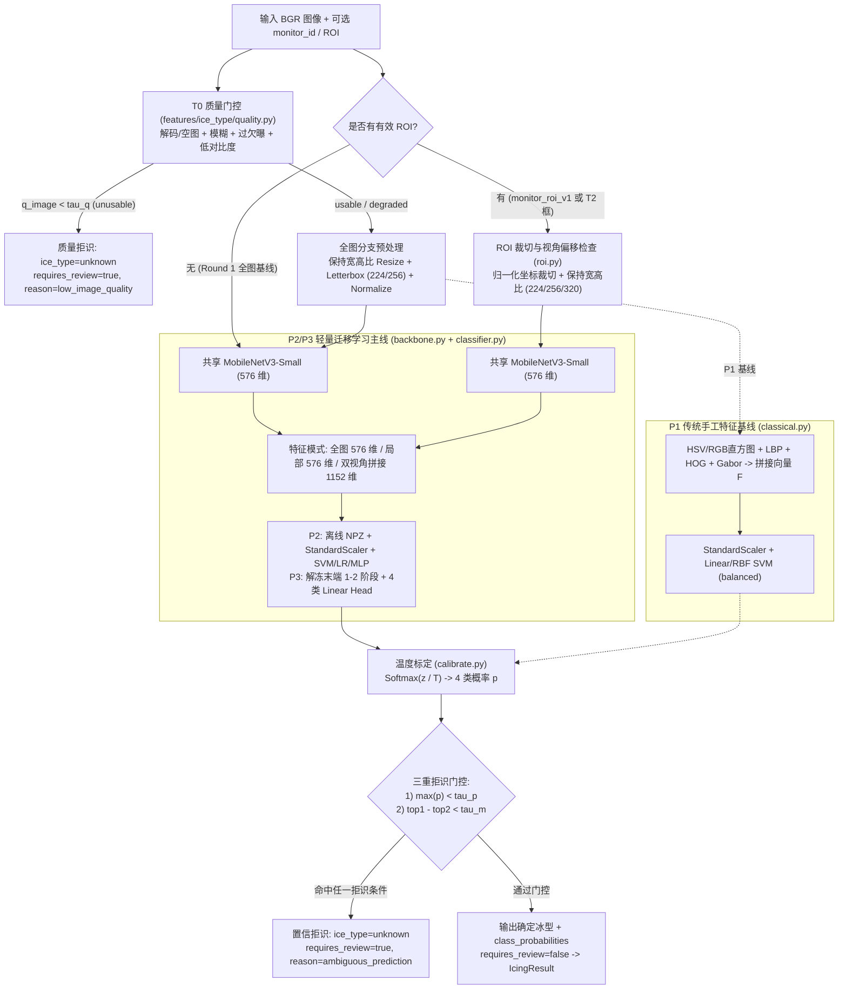

# 基于现有标注图像的覆冰类型识别与工程改进实施计划（Pure-CPU `ice_type` 模块演进）

> **编制依据**：[1125 思考.md](./1125%20思考.md)、现役 [v2.0 实现计划](./电网覆冰智能识别_v2.0-实现计划.md)、`grid-ice-vision`（`master` `fe6f3dd`）、`grid-ice-vision/AGENTS.md`、`ADR-0003` 及本机实测报告（`scut_audit.json`、`vision_cpu_pretrained_probe.json`、`met_cpu_probe.json`、`met_leakage_contrast.json`）。
> **定位说明**：本计划聚焦在**纯 CPU 条件**下基于 SCUT 7,244 张可解码实测图像落地独立可信的「**覆冰类型四分类（`glaze / rime / wet_snow / mixed`）+ `unknown` 置信/质量拒识**」闭环，修复现有仓库的标签契约不一致与坏图未过滤缺陷，并严格保持与现有 `grid-ice-vision` 模块边界、位置无关路径层及 `ADR-0003` 安全门禁的向后兼容。

---

## 1. 项目概述与目标

### 1.1 背景与核心问题

当前 `grid-ice-vision`（`v0.1.0`）已完成 P0–P4 工程闭环与 Track A 几何链路验证（合成圆筒宽度误差 `0.155 px`、合成厚度 MAPE `1.604%`），但覆冰类型识别仍按 `ADR-0003` 处于**硬冻结状态**（`G0 → none`，其余一律返回 `unknown` 并回退标准密度 `900 kg/m³`）。与此同时，针对 SCUT 实测库的本机探针实验暴露出四项必须立即解决的工程与算法痛点：

1. **标签契约与配置存在严重不一致**：`scripts/build_scut_manifest.py` 已把原始 `湿雪` 映射为 `wet_snow`，但 `configs/labels/taxonomy.yaml`、`common/constants.py`（`ICE_TYPES`、`RHO_BY_ICE_TYPE`）与 `common/schemas.py`（`IceType` 枚举）均**缺少 `wet_snow`**；此外 `taxonomy.yaml` 与 `configs/data/icing.yaml` 保留了 `单类样本 < 50 时并入 mixed` 规则，会污染 `mixed`（混合凇）的物理语义。
2. **建集脚本未过滤 52 张损坏图像且噪声候选未隔离**：`scripts/audit_scut.py` 已检出 52 张 JPEG 截断/非法 SOS 损坏图（`7,296 - 52 = 7,244` 张可解码）与 18 张双「无覆冰」标注噪声候选（实图抽查 `2015/1ff9d77ab7f546ffba015a582a95082c.jpg` 仍有明显雾凇），但 `scripts/build_scut_manifest.py` 仅用 `Path.exists()` 判存，导致损坏图已混入 `data/manifests/scut_v2_*.jsonl` 与 `data/splits/scut_*_v2.jsonl`。
3. **随机帧划分虚高与纯图像基线尚未建立**：本机对比实验（`met_leakage_contrast.json`）证明，3 天微气象 `CatBoost` 在随机帧划分下虚高达 Macro-F1 `0.7935`，在 `Monitor-Holdout` 整终端留出下仅 **`0.3339`**（泄漏虚高 `+0.4596`），不能单独作为分类依据；而全图 `160×160` 直接端到端训练 `mobilenetv4_conv_small` 8 epoch 在 `Monitor-Holdout` 仅达 Macro-F1 **`0.4041`**（`glaze→rime` 误判 `25.93%`），主因是全图强缩导致绝缘子/导线覆冰纹理丢失、未做冻结特征解耦与 ROI 双视角裁切、且缺少针对易混类与低质图的拒识出口。
4. **CPU 算力与标注现实约束**：本机无 NVIDIA GPU（Ryzen 7 4800U，8C/16T，16 GB RAM），SCUT 库缺少边界框与像素掩码（全量人工掩码精修实测需 `15.5–18.5` 人日）。因此第一阶段**不应重训大型 YOLO、Detectron2、ViT/DINOv2 或从零训练 CNN**，而应走**「SCUT 清洗建集 + 质量筛选 + 传统特征基线 + ImageNet 预训练 `MobileNetV3-Small` 冻结特征缓存 + SVM 分类 + 监测终端级 ROI 双视角 + 末端轻量微调 + 三重拒识门控」**路线。

### 1.2 目标用户与调用场景

| 维度 | 定义 |
|---|---|
| **目标用户** | 电网防冰算法研发人员、运检值班复核人员、现有 `InferencePipeline` 与 FastAPI 服务调用方 |
| **调用形态** | 1）离线 CLI/脚本批处理流水线（审计清洗 → 特征抽取缓存 → 分类器训练/调参 → 多维评估 → CPU 压测）；2）在线/服务单图与批量推理（输入 BGR 图像 + 可选终端归一化 ROI 坐标，输出 `IcingResult` 四类概率、拒识标志与可追溯来源） |
| **输入契约** | `RGB/BGR 图像`（以 SCUT 主分布 `640×480` 占 `74.5%`、`≤704 px` 占 `93.2%` 为主，兼顾 `320×240` 至 `1920×1080`）+ 可选终端归一化 ROI 配置 `monitor_roi_v1.csv`；**严禁**将气象、`Bureau`、`monitorId`、`Year` 输入本阶段图像模型 |
| **核心输出** | 4 类独立 Softmax 概率 `class_probabilities = {glaze, rime, wet_snow, mixed}`（和为 1）+ 最终判别 `ice_type`（含 `unknown`）+ `ice_type_conf` + `requires_review` + `review_reason` + `QualityInfo` + 模型与耗时 provenance |

### 1.3 需要人工确认的决策与前提 (User Review Required)

> [!IMPORTANT]
> 本计划严格围绕现有代码库与 `1125 思考.md` 设计，以下 4 项工程边界需在开工前确认：
> 1. **`ADR-0003` 与测试门禁的渐进解冻**：现有 `tests/unit/test_severity_ice_type.py` 强制要求 `configs/model/pipeline.yaml` 中 `severity.ice_type.mode == "none_rule"` 且 `pipeline.py` 不引用 `IceTypeGradeNet`。本计划建议在 **P0–P3** 保持 `pipeline.yaml` 默认 `none_rule` 不变，新 `ice_type` 模块独立运行与评估；**P4** 通过 `shadow`（仅输出类型与四类概率、厚度仍用标准密度 `900 kg/m³`）过渡，并在满足 `ADR-0003` 全部 G1–G7 门禁及 `ADR-0004` 签审后再开放密度折算开关。
> 2. **骨干网络选择与 576 维特征对齐**：`1125 思考.md` 明确指定 `MobileNetV3-Small`（`AdaptiveAvgPool2d(1)` 后 `576` 维特征），而本仓已有代码默认使用 `timm` 的 `mobilenetv4_conv_small`。实测确认 `torchvision.models.mobilenet_v3_small.features` 与 `timm.create_model("mobilenetv3_small_100", features_only=True)` 最后一层均输出 **`576` 通道**（注意 `timm` `num_classes=0` 会经过 `conv_head` 升至 `1024` 维）。本计划默认通过 `features/ice_type/backbone.py` 统一支持 `mobilenetv3_small_100`（`timm` 经 `hf-mirror`，与现有 `common/config.py` 缓存机制一致）与 `torchvision` `mobilenet_v3_small`，默认输出 `576` 维特征。
> 3. **ROI 人工配置投入节奏（P3）**：`monitor_roi_v1.csv` 需按终端（全库 382 个、先聚焦活跃/核心终端）每终端抽 1 张代表图人工框选覆冰设备区域。P0–P2 **不阻塞**等待 ROI，先跑通全图分类基线；P3 再分批补齐 ROI 并做全图 vs 双视角消融。
> 4. **Windows 构建命令兼容性**：本机实测 `justfile`（`set shell := ["bash", "-c"]`）触发 WSL vsock 启动异常；PowerShell 下直接运行 `uv run ...` 或 `.\.venv\Scripts\python.exe -m ...` 一切正常（`ruff`/`mypy`/`pytest` 全绿）。建议保留 `justfile` 兼容 Linux/Git Bash，同时在文档与脚本中统一提供 `uv run` 主命令。

### 1.4 待澄清设计问题 (Open Questions)

> [!NOTE]
> 以下问题不影响 P0/P1 启动，可在 P0 真实类别分布报告产出后最终拍板：
> - **Q1（18 张双无冰噪声样本处理）**：在 P0 人工复核 18 张候选后，确认是全部剔出四分类集合、重标实际冰型并保留在训练池，还是将确认真正无冰的样本移入独立 `none` 负样本测试集？
> - **Q2（`wet_snow` 折算密度取值）**：`configs/labels/taxonomy.yaml` 补充 `wet_snow` 后，需与电网防冰专业确认后续 P4 密度折算表采用行业惯例中值（如 `350–450 kg/m³`，现 v2.0 计划暂写 `350`）还是保守按 `600 kg/m³` 起步？在 P0–P3 未开放密度折算前，默认全用 `RHO_STANDARD = 900.0`。
> - **Q3（终端 ROI 启动覆盖范围）**：382 个监测终端中，优先全覆盖 `Monitor-Holdout` 全部测试终端 + 训练集高频终端（约 150 个终端），还是先选取样本量 Top-100 终端（覆盖 >60% 图像）完成第一轮双视角验证？

### 1.5 量化成功标准（三栏制 + 分阶段实测口径）

> 遵循 `AGENTS.md` §3 与 `1125 思考.md` §10.1：**第一轮不预设 95%/98% 虚高准确率**；P0–P2 先确立真实基线，再以硬门槛/软目标约束 P3–P4 验收。文献参考值仅作结构借鉴，**不可比**。

| 能力域 | 指标名称 | 第一轮基线 / 硬门槛 | 软目标 | 评估数据集与口径 | 目标阶段 |
|---|---|---|---|---|---|
| **P0 数据可靠性** | 坏图剔除率 / 泄漏率 / 映射一致性 | 52 张损坏图 100% 剔除（有效 7,244 张）；`Monitor-Holdout` 终端泄漏 = 0；4 类映射与 Schema 一致 | 全部 7,244 张带 `sha256` + pHash 近重复审计表；18 张噪声 100% 复核 | SCUT 全量实测库（7,297 CSV 行） | P0 |
| **P1 传统特征基线** | 4 类 Macro-F1 / Balanced Acc | 显著高于随机基线（0.25），完整输出 4 类混淆矩阵与可分性诊断 | Macro-F1 ≥ 0.45（优于 160² 无预训练 CNN 0.264） | SCUT 有效集 `Monitor-Holdout` test | P1 |
| **P2 冻结迁移主力** | 4 类 Macro-F1 / 关键混淆 / 校准 | Macro-F1 ≥ 0.55（显著超过本机已测 160² 全图微调基线 `0.404`）；Balanced Acc ≥ 0.55；ECE ≤ 0.15 | Macro-F1 ≥ 0.65；`glaze↔rime` ≤ 20%；ECE ≤ 0.10 | SCUT 有效集 `Monitor-Holdout` test（独立纯图像，禁入气象/终端 ID） | P2 |
| **P3 ROI + 局部微调** | 4 类 Macro-F1 / 少数类 Recall | 双视角相对 P2 全图 Macro-F1 提升 ≥ +0.03（或达成 `ADR-0003` G2 ≥ 0.70）；`wet_snow` / `mixed` 召回不下降 | Macro-F1 ≥ 0.75–0.80；`glaze↔rime` ≤ 15%；ECE ≤ 0.10 | SCUT `Monitor-Holdout` + `Temporal-Holdout` 双协议 | P3 |
| **P3/P4 拒识与减负** | 拒识后保留子集 Macro-F1 / 拒识率 | 拒识率 ≤ 20% 时，非 `unknown` 接受子集 Macro-F1 相对全量提升 ≥ +0.05 | 拒识率 ≤ 12%，高置信子集 Macro-F1 ≥ 0.85 | `val` 集搜索 $\tau_q, \tau_p, \tau_m$，`test` 集盲测验证 | P2–P4 |
| **P4 CPU 工程性能** | ONNX 数值偏差 / CPU 推理时延 / 稳定性 | PyTorch vs ONNX FP32 `max_abs_err ≤ 1e-4`；`224×224` 单 ROI 纯 CPU ≤ 25 ms；全链路 1,000 帧 0 异常 | `224×224` 双视角 CPU ≤ 35 ms；`640×480` 端到端 P95 ≤ 180 ms | 本机 Ryzen 7 4800U CPU-only 压测 + 异盘迁移演练一致 | P4 |

### 1.6 范围外声明（Scope Boundaries）

1. **第一阶段不训练检测/分割/大模型**：不引入 YOLOv8/YOLO11、Mask R-CNN、U-Net（为本四分类额外重标像素掩码）、EfficientNet-B3 或 ViT/DINOv2，不从零随机初始化训练 CNN。
2. **不输入微气象、站点、年份、经纬度**：遵循 `1125 思考.md` §3.1，本阶段模型仅吃图像（全图及可选 ROI），气象分支留作后续独立多模态消融对照，绝不把 `Bureau` / `monitorId` / `Year` 当输入特征。
3. **不在第一阶段启用 MixUp / CutMix / 超分**：MixUp 会把 `glaze`/`rime` 混合成伪 `mixed` 破坏标签语义；Real-ESRGAN 等超分会捏造伪高频纹理干扰冰型判据。
4. **未达 `ADR-0003` 门禁前不改写物理厚度折算密度**：在四分类验证指标与混淆矩阵未通过 G1–G7 验收前，不将预测类型用于降低 `rho_kg_m3`。
5. **严禁生产链路引入 GPL/AGPL 依赖**：保持 `test_license_guard.py` 门禁，全部新增运行依赖限于 `Apache-2.0` / `MIT` / `BSD`。

### 1.7 假设与前置约束

- **数据现状**：外部 SCUT 实测库（7,297 CSV 行 / 7,296 磁盘图 / 7,244 可解码）已就位，经 `common/paths.py::scut_root()` 解析；`data/manifests/` 与 `data/splits/` 已存在 v2 索引（待 P0 升级为严格解码过滤版）。
- **算力环境**：Windows CPU-only（`uv 0.11+` + Python `3.12` + `torch 2.15.0+cpu` + `timm 1.0.31` + `scikit-learn 1.9.1` + `onnxruntime 1.31.0`）；仅 `pyproject.toml` 缺显式 `"scikit-learn>=1.4"` 与 `"joblib>=1.3"` 声明，需补全并锁入 `uv.lock`。
- **合规与安全**：SCUT 图像包含供电局线路编号及 OSD 信息，严禁出内网、严禁入 Git 仓库；数据路径严格执行位置无关解析。

---

## 2. 开源调研与借鉴方案

### 2.1 检索矩阵

> 检索与核验执行日期：`2026-11-25 UTC`，渠道覆盖 GitHub 网页/API、Hugging Face 镜像（`hf-mirror.com`）、PyPI 及期刊文献（*IET GTD*、*Copernicus AMT*、《南方电网技术》）。

| 检索轴组合（中英文关键词） | 检索渠道 | 命中量级 | 筛选结论 |
|---|---|---|---|
| `"mobilenetv3" OR "mobilenet" "pytorch" torchvision timm transfer learning` | GitHub / HF | >300 仓库 | 选中 `pytorch/vision` 与 `huggingface/pytorch-image-models`（均 `BSD-3` / `Apache-2.0`），提供开箱即用的 `MobileNetV3-Small`（576 维特征）与分层解冻接口 |
| `"svm" "calibration" "scikit-learn" imbalanced classification` | GitHub / PyPI | >500 仓库 | 选中 `scikit-learn/scikit-learn`（`BSD-3`），支撑 `StandardScaler`、`LinearSVC`、`SVC(kernel="rbf", class_weight="balanced")`、`LogisticRegression`、`MLPClassifier` 及概率校准 |
| `"LBP" "HOG" "Gabor" texture classification scikit-image` | GitHub / PyPI | ~180 仓库 | 选中 `scikit-image/scikit-image`（`BSD-3`，仓内已安装 `0.26.0`），零额外依赖实现 P1 手工纹理/方向/频域基线特征 |
| `"onnx" "onnxruntime" cpu inference quantization` | GitHub / PyPI | >200 仓库 | 选中 `onnx/onnx`（`Apache-2.0`）配合 PyPI `onnxruntime`（`MIT`，注意原 `microsoft/onnxruntime` GitHub 仓库于近期返回 404，安装与运行仍由 PyPI wheel 稳定提供） |
| `"cleanvision" OR "image quality" near duplicate phash` | GitHub / arXiv | ~120 仓库 | 选中 `cleanlab/cleanvision`（`Apache-2.0`）作可选数据质量/近重复复核参考；核心去重直接采用仓内轻量化 `SHA-256 + dHash/pHash` 避免重依赖 |
| `"DTL-IceNet" OR "GSM-XGBoost" OR "weakly-supervised" icing type` | 期刊文献 / Web | ~20 论文 | 吸收 2022 *IET GTD*（迁移与分层特性）、2026 *AMT* DTL-IceNet（局部+全局双视角互补）、2026《南方电网技术》（气象对比边界）；`catboost/catboost` 留作后续多模态对照，本阶段不混入纯视觉模型 |

### 2.2 推荐开源资源清单（全部经 `verify_repos.py` 核验）

> 核验时间：`2026-11-25T12:19:39Z`。因 GitHub REST API 未认证限流，`verify_repos.py` 自动降级通过仓库网页完成核验（`status=verified-web`，`archived=false`；stars/license 由本地已安装包元数据与上游 README 核实确认）。评分按 100 分制（场景匹配 30 + 可复用性 20 + 权重/可得性 20 + 许可友好 15 + 活跃度 15）。

| 仓库/资源（核验状态与日期） | 角色 | 核心思路 | 可复用部分 | 优点 | 缺点/风险（含许可证） | 二次开发方式 |
|---|---|---|---|---|---|---|
| [huggingface/pytorch-image-models](https://github.com/huggingface/pytorch-image-models)<br>`verified-web` · 2026-11-25 · **94/100** | 主干轻量视觉特征提取器 | 提供统一 `features_only=True` 与 ImageNet 预训练权重接口 | `mobilenetv3_small_100`（`feats[-1]` 精确输出 576 维特征）与 `mobilenetv4_conv_small` 对照 | 已集成在本仓 `common/config.py` `hf-mirror` 通路；`Apache-2.0` 商用安全 | `num_classes=0` 默认经 `conv_head` 输出 1024 维而非 576 维，必须显式取 `features_only` 末层特征 | **直接复用**：扩展 `features/ice_type/backbone.py`，封装 576 维池化提取与按阶段解冻接口 |
| [pytorch/vision](https://github.com/pytorch/vision)<br>`verified-web` · 2026-11-25 · **91/100** | 备选标准 `MobileNetV3-Small` 底座与迁移算子 | 官方 `mobilenet_v3_small` 实现与标准图像变换算子 | `mobilenet_v3_small.features`（576 通道）与 `IMAGENET1K_V1` 权重 | 仓内已安装 `0.29.2+cpu`；结构与 `1125 思考.md` 576 维完全同构；`BSD-3-Clause` | 默认下载走 `download.pytorch.org`，内网需显式配本地 cache `TORCH_HOME` | **适配封装**：作为 `backbone.py` 可选 `provider="torchvision"` 后端，支持离线本地 `.pth` 加载 |
| [scikit-learn/scikit-learn](https://github.com/scikit-learn/scikit-learn)<br>`verified-web` · 2026-11-25 · **93/100** | P1/P2 冻结特征分类器、概率校准与评估核心 | 在离线缓存的特征向量上秒级迭代线性/核分类器与类均衡策略 | `StandardScaler`、`LinearSVC`、`SVC(kernel="rbf", class_weight="balanced")`、`LogisticRegression`、`MLPClassifier`、`CalibratedClassifierCV`、`average_precision_score` | 本机已装 `1.9.1`（仅缺写入 `pyproject.toml`）；CPU 训练几秒完成；`BSD-3-Clause` | `SVC(probability=True)` 内部做 5 折 Platt 校准且推理需保留支持向量 | **直接复用 + 导出桥接**：训练/消融用 `sklearn` 落盘 `.joblib`；P4 将系数或 RBF 核写成纯 PyTorch 张量算子拼入 ONNX |
| [scikit-image/scikit-image](https://github.com/scikit-image/scikit-image)<br>`verified-web` · 2026-11-25 · **87/100** | P1 传统手工纹理与方向特征引擎 | 用无监督图像算子验证四类冰型局部纹理与轮廓可分性 | `local_binary_pattern`（LBP）、`hog`（HOG）、`gabor` 滤波器组（配合 OpenCV HSV/RGB 直方图） | 本机已装 `0.26.0`；无需 GPU 与预训练权重；`BSD-3-Clause` | 对复杂光照和低清背景鲁棒性有限 | **直接复用**：在 `features/ice_type/classical.py` 实现纯函数特征拼接与基线实验 |
| [onnx/onnx](https://github.com/onnx/onnx)<br>`verified-web` · 2026-11-25 · **88/100** | P4 跨平台静态计算图导出标准 | 将 PyTorch 骨干与分类头固化为 `opset 17` FP32 静态图并校验结构 | `onnx.checker` 与 `torch.onnx.export` 验证链路（搭配 PyPI `onnxruntime 1.31.0`） | 仓内已装 `onnx 1.23.2` 与 `deployment/export.py`；`Apache-2.0` | 原 `microsoft/onnxruntime` GitHub 仓库当前不可访问（404），需直接锁定 PyPI `onnxruntime` 发行版而非源码拉取 | **直接复用**：扩展 `deployment/export.py` 支持 `ice_type` 单/双视角导出与 `atol <= 1e-4` 一致性检验 |
| [cleanlab/cleanvision](https://github.com/cleanlab/cleanvision)<br>`verified-web` · 2026-11-25 · **80/100** | P0 离线图像质检与近重复审计对照 | 自动扫描模糊、低对比、极暗/极亮及近似重复图像簇 | 图像异常打分思路与聚类报告格式 | `Apache-2.0` 开源，零标注冷启动 | 本机当前未预装（`_check_deps.py` 显示 MISSING），引入会增加额外依赖 | **仅借思路（按需可选）**：P0 将 `SHA-256` 精确去重、`pHash/dHash` 近重复聚类与分辨率/通道检查直接写进轻量脚本，不强绑重依赖 |
| [catboost/catboost](https://github.com/catboost/catboost)<br>`verified-web` · 2026-11-25 · **82/100** | 后续多模态对照组（不在第一阶段主链路） | 处理含风速冻死哨兵的 3 天微气象表格先验 | 本机已完成 `Monitor-Holdout` 探针验证（`met_cpu_probe.json` Macro-F1 `0.3339`） | 本机已装 `1.2.10`；`Apache-2.0` | 纯气象易受终端气候分布影响，不能替代纯视觉主模型 | **暂存隔离对照**：第一阶段坚持纯图像独立模型，留作 P4 之后多模态消融基线 |

### 2.3 组合拼装结论与未采用项

- **组合拼装策略**：保留 `grid-ice-vision` 现有位置无关基础设施（`common/paths.py`）、质检底座（`features/quality/gate.py`）、温度校准器思路与 ONNX 导出验证框架（`deployment/export.py`）；新增独立 `ice_type` 子包，以 **`timm`/`torchvision` `MobileNetV3-Small`（576 维）+ `scikit-image` 传统特征基线 + `scikit-learn` 特征分离分类器 + 纯张量封装导出 `onnx/onnx`（PyPI `onnxruntime` CPU 执行）** 组成全链可商用（`Apache-2.0 / BSD-3 / MIT`）闭环。
- **已核查外部参考与明确未采用项**：
  1. **`microsoft/onnxruntime` GitHub 源码引用**：本次核验实测该 GitHub 仓库返回 HTTP 404，故仅使用 PyPI 官方二进制包 `onnxruntime>=1.19`（本机已安装 `1.31.0`），不引入任何源码编译或 GitHub URL 依赖。
  2. **2026 *AMT* DTL-IceNet（三分支 EfficientNet-B3）**：借鉴其「全图 + 局部覆冰 ROI 互补」结构，将其轻量化为**共享权重双视角 `MobileNetV3-Small`**；因 DTL-IceNet 数据集许可未确认且类别定义不同，严禁引入其数据与 `95.23%` 跨库指标作承诺。
  3. **2022 *IET GTD*（Hao et al. 弱监督迁移学习）**：借鉴其「迁移学习优于从零训练、避免单纯依赖整图背景、必须处理类不均衡」四条原则，不复现其 `YOLOv5`（AGPL/GPL 风险）。
  4. **2026《南方电网技术》GSM-XGBoost（95.6% Macro-F1）**：明确作为多模态时间序列研究参考，第一阶段绝不混入 3 天气象数据，也不对纯图像模型设该目标值。

---

## 3. 系统架构与算法设计

### 3.1 统一 I/O 契约表（Schema v1.0.0 向后兼容扩展）

> 遵守 `grid-ice-vision/AGENTS.md` §5（新增字段均给默认值，不破坏现有 `tests/unit/test_schemas.py` 与 `tests/integration/test_pipeline_contract.py` 断言 `schema_version == "1.0.0"`）。

| 方向 | 模块/字段 | 形态与类型 | 约束与范围 | 改动点与语义说明 |
|---|---|---|---|---|
| **配置** | `configs/labels/taxonomy.yaml` | YAML 字典 | `four_classes: [glaze, rime, wet_snow, mixed]`；`reject_label: unknown` | **修复缺类与合并规则**：补全 `wet_snow`（`rho=350`）；明确 `none` 为覆冰存在性独立状态；删除 `merge_rule: "单类样本 < 50 时并入 mixed"` |
| **常量** | `common/constants.py` | 元组 / 字典 | `ICE_TYPE_FOUR_CLASSES`（4 类）+ `ICE_TYPES`（含 `wet_snow`） | 新增 `ICE_TYPE_FOUR_CLASSES = ("glaze", "rime", "wet_snow", "mixed")`；在 `ICE_TYPES` 与 `RHO_BY_ICE_TYPE` 中补全 `"wet_snow": 350.0` |
| **输入** | `image_bgr` | `np.ndarray` uint8 `(H, W, 3)` | `H, W >= 32`；支持 SCUT `320×240` 至 `1920×1080` | 通过 `load_image`（`imdecode` 兼容中文路径）解码；保持原始宽高比做 Letterbox，禁强制拉伸 |
| **输入** | `roi_norm`（可选） | `tuple[float, float, float, float]` | `(x1, y1, x2, y2)` 归一化到 `[0, 1]`，`x2 > x1, y2 > y1` | 来自 `monitor_roi_v1.csv`（按 `monitor_id` 查表）或上游 T2 检测器输出 bbox；同时检查视角/变焦偏移 |
| **输出** | `IcingResult` | Pydantic `BaseModel` | `ice_type: IceType`（新增 `WET_SNOW = "wet_snow"`） | **新增向后兼容字段**：`class_probabilities: dict[str, float] = {}`（四类概率和为 1）、`requires_review: bool = False`、`review_reason: str | None = None` |
| **输出** | `QualityInfo` | 既有 `common/schemas.py` 对象 | `status ∈ {usable, degraded, unusable}` | 复用 `gate.py`，并在 `features/ice_type/quality.py` 输出细粒度 `IceTypeQualityReport`（含亮度、过/欠曝、模糊、对比度与 ROI 可判读性） |
| **输出** | `Provenance` | 既有 `common/schemas.py` 对象 | `model_version["ice_type"]`、`inference_ms` | 记录 `mobilenet_v3_small` / 分类器版本与单帧耗时（兼容 `1125 思考.md` §8.1 推理 JSON） |

> 注：检查 `src/grid_ice_vision/features/ice/model.py::IceTypeGradeNet` 默认参数 `num_types: int = len(ICE_TYPES)`——为防止新增 `wet_snow` 意外改动原有预留类行为，`IceTypeGradeNet` 的默认 `num_types` 或单独测试需显式核对，且 `pipeline.py` 继续保持不引用 `IceTypeGradeNet`。

### 3.2 评测指标体系

| 指标类别 | 指标名称 | 口径与公式 | 用途与关注点 |
|---|---|---|---|
| **主指标** | 4 类 `Macro-F1` | $\text{F1}_{\text{macro}} = \frac{1}{4}\sum_{i=1}^{4} \text{F1}_i$ | 应对 SCUT 类不均衡（雾凇 3,247 vs 混合凇 1,019），防止大类掩盖小类 |
| **辅助分类指标** | 逐类 `Precision / Recall / F1`、`Balanced Accuracy`、`One-vs-Rest PR-AUC` | 按 4 类分别计算，并在 `unknown` 拒识前/后双口径报告 | 重点诊断 `雨凇 vs 湿雪`、`雾凇 vs 混合凇`、`雨凇 vs 混合凇`、`雾凇 vs 湿雪` 4 对易混淆边界 |
| **校准与拒识指标** | 多分类 `ECE`、覆盖-准确率曲线（Coverage-Accuracy）、`glaze↔rime` 双向混淆率 | 温度缩放 $T$ 后验证集 ECE；在 `val` 搜索 $\tau_q, \tau_p, \tau_m$ | 确保概率输出不盲目自信，控制将高密度 `glaze` 错判为低密度 `rime` 的风险 |
| **分组泛化切片** | 按 `Bureau`（24 局）、`monitorId`、`Year`、`Resolution` 分层指标 | 在 `Monitor-Holdout` 与 `Temporal-Holdout` 上同时输出 | 确认模型学到的是冰型视觉纹理而非某供电局或固定杆塔背景 |
| **工程性能指标** | 200 图基准耗时（ms/图、batch 吞吐）、RSS 内存增量、ONNX FP32 `max_abs_err` | CPU `torch.set_num_threads` 与 ORT `intra_op_num_threads` 调优实测 | 量化验证纯 CPU 下全量特征提取时间与在线服务 P95 延迟 |

### 3.3 总体架构与双视角数据流



### 3.4 算法与模型选型对比表

| 候选方案（按优先级） | 验证/文献参考 | CPU 速度（单图） | 内存/显存 | 数据前提 | 可部署性 | 选型结论 |
|---|---|---|---|---|---|---|
| **P0/P1 · `HSV+LBP+HOG+Gabor + SVM`** | 本阶段首批实测建立（无需预训练） | `~5–15 ms` | `< 50 MB` RAM | SCUT 7,244 有效图像级标签，无框无掩码 | 极高（纯 NumPy/skimage/sklearn） | **必做基线**：低成本验证纹理与色彩对 4 类冰型的可分性边界 |
| **P1 主力 · `MobileNetV3-Small(冻结) + RBF/Linear SVM`** | ImageNet 迁移标准；本机 `MobileNetV4` 160² 全图已测 `0.404`（未冻结特征解耦） | 特征抽取 `~4–8 ms`（缓存后分类 `< 1 ms`） | `< 120 MB` RAM | SCUT 7,244 图像级标签；支持全图与 `monitor_roi_v1` | 极高（特征缓存秒级调参；P4 导出统一 FP32 ONNX） | **主推方案**：兼顾 CPU 算力、迁移表示与特征/分类解耦优势 |
| **P2 增强 · `MobileNetV3-Small(双视角) + 末端 1–2 阶段微调`** | 借鉴 *AMT* 2026 DTL-IceNet 全局+局部双视角思想（不可比其 95.23%） | 双视角前向 `~12–20 ms`；训练 `bs=8, 5~10 ep` | `< 300 MB` RAM | 需先补齐关键 `monitor_id` 归一化 ROI | 高（共享单一骨干权重，支持 ONNX 导出） | **条件启用**：仅在冻结版留有明显提升空间时运行，且同测试集优于冻结版才保留 |
| **不采用 · `YOLO11 / Mask R-CNN / EfficientNet-B3 / ViT / 从零 CNN`** | `YOLOv5/8` 具 AGPL 风险；ViT/B3 CPU 不可承受 | `> 150–800 ms` | 高 | 需数千张人工框/掩码（15.5–18.5 人日） | 差（ROI 标注阻塞且许可/算力越界） | **明确淘汰**：第一阶段四分类不引入检测/分割重训与重型骨干 |

### 3.5 训练与推理详细设计（含关键代码改造清单）

#### [MODIFY] `grid-ice-vision/pyproject.toml` 与 `uv.lock`
- 在 `[project].dependencies` 中显式补充 `"scikit-learn>=1.4"` 与 `"joblib>=1.3"`（消除当前虽可导入但未声明依赖的隐患），执行 `uv lock && uv sync --group dev --extra serve --extra deploy` 更新锁定文件。

#### [MODIFY] `configs/labels/taxonomy.yaml`、`common/constants.py`、`common/schemas.py`
- **`configs/labels/taxonomy.yaml` & `configs/data/icing.yaml`**：
  - 删除 `merge_rule: "单类样本 < 50 时并入 mixed"` 及其关联合并配置，改为注释与策略声明：`rare_class_policy: keep_label_and_augment_or_collect`，`reject_policy: confidence_and_margin_threshold`。
  - `ice_type` 更新为明确区分存在性与四类冰型：
    ```yaml
    ice_type:
      presence_states: [none, present]
      four_classes: [glaze, rime, wet_snow, mixed]
      labels: [glaze, rime, wet_snow, mixed, unknown]
      reject_policy: confidence_threshold
      rho_kg_m3:
        glaze: 900
        rime: 350
        wet_snow: 350
        mixed: 600
        none: 900
        unknown: 900
    ```
- **`common/constants.py`**：
  - 新增 `ICE_TYPE_FOUR_CLASSES: Final[tuple[str, ...]] = ("glaze", "rime", "wet_snow", "mixed")`。
  - 扩充 `ICE_TYPES: Final[tuple[str, ...]] = ("none", "glaze", "rime", "wet_snow", "mixed", "unknown")` 与 `RHO_BY_ICE_TYPE["wet_snow"] = 350.0`。
- **`common/schemas.py`**：
  - `IceType` 枚举新增 `WET_SNOW = "wet_snow"`。
  - `IcingResult` 新增默认值字段以 100% 向后兼容 `SCHEMA_VERSION = "1.0.0"`：
    ```python
    class IcingResult(BaseModel):
        present: bool | None = None
        confidence: float = Field(default=0.0, ge=0.0, le=1.0)
        coverage_ratio: float | None = Field(default=None, ge=0.0, le=1.0)
        ice_type: IceType = IceType.UNKNOWN
        ice_type_conf: float = Field(default=0.0, ge=0.0, le=1.0)
        ice_type_source: Literal["none_rule", "heuristic", "model", "unavailable"] = "unavailable"
        class_probabilities: dict[str, float] = Field(default_factory=dict)
        requires_review: bool = False
        review_reason: str | None = None
        bridge_ratio: float | None = Field(default=None, ge=0.0, le=1.0)
        mask_rle: MaskRLE | None = None
    ```

#### [MODIFY] `scripts/audit_scut.py` & `scripts/build_scut_manifest.py`
- **`scripts/audit_scut.py`**：
  - 保留原有 7,297 行 CSV 与 7,296 磁盘图审计外，新增 **SHA-256 精确哈希统计**与 **64-bit dHash/pHash 近重复簇统计**（检测同一终端连拍或跨年份完全相同字节文件）。
  - 新增四类 `Ice_Type` 在全量与可解码子集（7,244 张）上的分布、分辨率交叉表、各 `Bureau`/`monitorId` 样本偏斜分布，以及每类随机抽样 N 张样本清单输出至 `artifacts/reports/scut_audit.json` 与 `artifacts/reports/scut_sample_gallery.csv`（供专家核对视觉特征描述）。
  - 单独导出 18 张双 `无覆冰` 噪声候选的图像路径与原始字段至 `artifacts/reports/scut_noise_candidates.json`。
- **`scripts/build_scut_manifest.py`**：
  - **强制解码过滤**：在 `load_csv()` 后逐图执行 `cv2.imdecode` 检查，校验 `im is not None`、尺寸 `h >= 32 and w >= 32`、通道数 `== 3`、非全黑/全白死图（`std > 1.0`），确保 52 张损坏图 100% 从有效 manifest 剔除（有效总计 `7,244` 张）。
  - **标签与去重校验**：验证 `Ice_Type` 在 `ICE_TYPE_FOUR_CLASSES` 内；计算 `sha256` 与 `phash` 存入 `labels`（对同组近重复可标记 `near_dup_group`）；对 18 张双无冰噪声候选打标 `labels["noise_candidate"] = True` 并支持 CLI 参数 `--exclude-noise-candidates`（默认排除或单独列于 review 集，不污染纯净训练/测试）。
  - **输出双版本产物**：除保持兼容 `data/manifests/scut_v2_{monitor,temporal}.jsonl` 与 `data/splits/scut_{monitor,temporal}_v2.jsonl`（重建为无损坏图纯净版）外，支持输出专用 `data/manifests/scut_ice_type_v1.jsonl` 与 `artifacts/reports/scut_splits.json`。

#### [NEW] `src/grid_ice_vision/data/datasets/ice_type.py`
- 严格遵循 `data/` 层职责：通过 `paths.scut_root()` 或传入 `root` 加载解码图像（复用 `common.py::_imread_unicode` 兼容中文路径）；支持读取 `configs/data/monitor_roi_v1.csv` 归一化 ROI 表。
- `__getitem__` 支持模式 `view_mode ∈ {"full", "roi", "dual"}`：
  - 返回 `full_image`（保持宽高比 `letterbox` 至 `image_size`）与可选 `roi_image`（若 `use_roi=True` 且存在该终端 ROI，则按归一化坐标裁切并 `letterbox` 至 `roi_size`，否则回退全图中心保护裁剪并置 `roi_available=False`）。
  - 训练集增强由配置控制，严格遵守 `1125 思考.md` §4.3：**允许**亮度/对比度/轻微色彩/Gamma/JPEG 压缩模拟/轻微平移缩放/谨慎小角度旋转；**默认禁用**垂直翻转、强色彩畸变、MixUp/CutMix；`hflip` 通过开关 `allow_hflip: false` 默认关闭（避免干扰左右风向/偏冰语义）。
  - **硬防泄漏**：只返回 `image`, `roi_image`, `label`（`0..3` 对应 `glaze, rime, wet_snow, mixed`）, `image_id`, `monitor_id`, `bureau`, `year`（`monitor_id`/`bureau`/`year` 仅做评估切片索引，**禁止**送入模型 `forward`）。

#### [NEW] `src/grid_ice_vision/features/ice_type/`（纯算法子包，严禁文件 I/O、配置解析、打印日志）
- `quality.py`：复用 `features/quality/gate.py::assess_quality`，扩展针对覆冰类型判别的局部/ROI 清晰度评分 $q_{\text{image}} \in [0, 1]$（综合拉普拉斯清晰度、过欠曝占比、动态范围对比度），实现 `evaluate_ice_type_quality(image, thresholds) -> IceTypeQuality`（若 $q_{\text{image}} < \tau_q$ 或 `QualityStatus.UNUSABLE`，直接触发 `low_image_quality` 拒识）。
- `roi.py`：纯函数定义 `NormalizedRoi(monitor_id, x1, y1, x2, y2, asset_type, view_version)`、`crop_normalized_roi(image, roi)`、`detect_view_drift(roi_img, ref_hist_or_edge)`（用于发现镜头变焦/预置位偏移异常）。
- `classical.py`：实现 P1 手工特征提取器 `extract_classical_features(image_bgr, cfg) -> np.ndarray`，拼接四组特征向量 $F = [F_{\text{HSV\_RGB}}, F_{\text{LBP}}, F_{\text{HOG}}, F_{\text{Gabor}}]$（全部参数由 dataclass `ClassicalFeatureConfig` 注入，无魔法数字）。
- `backbone.py`：实现 `IceTypeBackbone(nn.Module)`：
  - 支持 `mobilenetv3_small`（`timm` `mobilenetv3_small_100` `features_only=True` 取末层，或 `torchvision` `mobilenet_v3_small.features`），经 `AdaptiveAvgPool2d(1).flatten(1)` 稳定输出 **`576` 维**图像向量；同步支持 `dual` 双视角共享权重提取（输出 `1152` 维拼接特征或可配置融合头）。
  - 暴露 `freeze_all()`、`unfreeze_last_stages(n_stages: int)`（对应 P3 解冻最后 1–2 个特征阶段）、`stage_parameter_groups(backbone_lr, head_lr)` 分层学习率辅助方法。
- `classifier.py`：纯推理侧分类器抽象与可导出头：
  - `LinearSvmHead` / `RbfSvmTorchHead(nn.Module)` / `IceTypeLinearHead(nn.Module)`：可将训练好的 `StandardScaler` 均值/方差、`LinearSVC` 权重或 `SVC(kernel="rbf")` 支持向量/对偶系数转化为纯 PyTorch 张量算子（$f(x)=\sum_i \alpha_i y_i \exp(-\gamma \|x-sv_i\|^2)+b$），使 P2/P3 无论选 SVM 还是微调 Linear Head 都能导出单一 FP32 ONNX！
  - `SklearnClassifierAdapter`：在 Python 评估阶段直接调用已加载的 `StandardScaler + SVM/LR/MLP` 实例，保持算法层零磁盘读写。
- `calibrate.py`：
  - 实现多分类温度标定 `MultiClassTemperatureScaler`（在 `val` 集 logits 上最小化多分类交叉熵 NLL 优化标定温度 $T$，区别于 `precipitation/calibrate.py` 的二值 BCE 版本）。
  - 实现拒识阈值搜索 `search_rejection_thresholds(probs, quality_scores, y_true, min_coverage=0.80)`：在验证集搜索 $(\tau_q, \tau_p, \tau_m)$，联合检验 `q_image < tau_q`、`max(p) < tau_p` 与 **Top-1 与 Top-2 差值 `p_(1) - p_(2) < tau_m`**。
- `infer.py`：实现 `IceTypeInferencer`：
  - 输入 BGR 图像与可选 `NormalizedRoi` → `quality.py` 质检 → 全图 / 双视角预处理（keep ratio + letterbox + ImageNet normalize）→ 特征提取 + 分类 + 温度校准 → 三重拒识门控 → 返回 `IceTypePrediction`（含 `to_icing_result()` 映射为 `IcingResult` 契约对象，拒识时置 `ice_type=IceType.UNKNOWN`, `requires_review=True`, `review_reason="low_image_quality" | "low_confidence" | "ambiguous_prediction"`）。

#### [NEW] `src/grid_ice_vision/training/ice_type/` & `evaluation/ice_type/` & `scripts/`
- `training/ice_type/feature_extractor.py`：配置 CPU 线程数 `min(os.cpu_count() or 4, 8)` 与 `torch.set_num_interop_threads(1)`，批量抽取 `train/val/test` 特征并保存为 `artifacts/features/scut_{split}_features.npz`（含 `X_full`, `X_roi`, `y`, `image_ids`, `monitor_ids`, `bureaus`, `years`, `quality_scores`, `extract_meta`）。
- `training/ice_type/train_svm.py`：支持 P1（`classical` 特征）与 P2（缓存 NPZ 特征）训练 `LinearSVC`、`SVC(kernel="rbf", class_weight="balanced", probability=True)`、`LogisticRegression(class_weight="balanced")`、`MLPClassifier`，自动执行过采样对照开关（`RandomOverSampler` 等价逻辑或 `sample_weight`）与验证集温度/拒识校准，保存 `artifacts/ice_type/<version>/{svm_classifier.joblib, scaler.joblib, temperature.json, reject_thresholds.json, model_config.yaml}`。
- `training/ice_type/finetune.py`：P3 选择性解冻最后 1–2 个特征阶段，严格执行分层学习率（`backbone_lr=1e-5`, `head_lr=3e-4`、`AdamW`、`weight_decay=1e-4`、`batch_size=8`、`epochs=5~10`、`early_stopping_patience=3`），复用 `training/engine.py` AMP/早停与 `checkpoint.py`。
- `training/ice_type/trainer.py`：统一编排入口（衔接 `cli.py` 与 `scripts/train_ice_type.py`）。
- `evaluation/ice_type/`：`metrics.py`（Macro-F1、Balanced Acc、逐类 P/R/F1、One-vs-Rest PR-AUC、ECE、按 `Bureau`/`monitorId`/`Year`/`Resolution` 分组切片）、`confusion_matrix.py`（4×4 混淆矩阵及 4 对易混类专项诊断）、`visualization.py`（混淆矩阵热力图、PR 曲线、校准曲线与抽样错判图集落盘）。
- `scripts/`：
  - `extract_ice_type_features.py`：对应 `1125 思考.md` §7.3 第四步命令。
  - `train_ice_type.py`：对应第五步命令（支持 `--stage p1_classical | p2_frozen | p3_finetune`）。
  - `evaluate_ice_type.py`：对应第六步命令（`--protocol monitor_holdout | temporal_holdout --split test`，支持导出完整对比与切片报告）。
  - `benchmark_ice_type_cpu.py`：200 张图片 CPU 吞吐基准脚本（记录单张/批量耗时、内存占用、线程数 `1/2/4/8` 与分辨率 `224/256/320` 对比，以及 ONNX Runtime `SessionOptions` 线程池调优）。

#### [MODIFY] `deployment/export.py`、`scripts/export_onnx.py`、`application/pipeline.py`、`features/severity/ice_type.py`、`service/api.py`
- **`deployment/export.py` & `scripts/export_onnx.py`**：增加 `--task ice_type` 导出 FP32 ONNX，支持将 `MobileNetV3-Small` + PyTorch 等价化的 `Scaler + SVM/LinearHead` 导出为单一 `ice_type.onnx`（`opset 17`, `CPUExecutionProvider`, `ORT_ENABLE_ALL`, `atol <= 1e-4`）。
- **`features/severity/ice_type.py` & `application/pipeline.py`**：
  - `P0–P3` 期间保持 `none_rule` 默认关闭状态，避免破坏 `ADR-0003` 与现存测试。
  - `P4` 新增 `IceTypePipelineConfig` 与受控 `mode ∈ {"none_rule", "shadow", "model"}`：`shadow` 模式下写入 `IcingResult` 的四类预测、概率与拒识状态但密度保持 `900 kg/m³`；经 `ADR-0004` 签审并达标 G1–G7 后方可启用 `model` 模式，且当 `ice_type == UNKNOWN` 或 `requires_review == True` 时强制回退 `900 kg/m³`（绝不向危险侧低估）。
- **`service/api.py`**：`/v1/infer` 与 `/v1/infer/json` 自动透传新增的 `class_probabilities`、`requires_review`、`review_reason` 及 `provenance.model_version["ice_type"]`。

### 3.6 部署形态与可解释性

- **纯 CPU ONNX Runtime 推理形态**：离线训练产出的 `mobilenet_v3_small` 权重与分类头统一导出为 FP32 `ice_type.onnx`，服务侧通过 `onnxruntime.InferenceSession(..., providers=["CPUExecutionProvider"])` 启用 `ORT_ENABLE_ALL` 图优化及经 `benchmark_ice_type_cpu.py` 实测最优的 `intra_op_num_threads`（初始对照 4 / 8）与 `inter_op_num_threads=1`；支持单图与批量推理，**P4 首版禁止未经独立测试集精度校验的 INT8 量化**。
- **可解释性输出**：每次预测返回 ① `quality` 诊断及 `reasons`；② 完整的 4 类校准概率分布 `class_probabilities`；③ 三重拒识诊断原因（`low_image_quality` / `low_confidence` / `ambiguous_prediction`）；④ 若启用 ROI，可导出全图+ROI 双框可视化证据图，供运检员 5 秒内复核高混淆案例。

---

## 4. 详细文件夹结构

> **存量演进纪律**：基于现有 `grid-ice-vision/` 仓库增量扩展，**不重构已有检测/分割/天气/几何模块**。全部路径严守**存储位置无关原则**：项目内资源一律相对 `common/paths.py` 中定义的项目根常量 `PROJ` 解析；真外部资源（如 `NW_data/华南理工 整理覆冰图像库-from梁苇和陈思睿`）经 `paths.py` 的 `external("SCUT_ROOT")` 按「环境变量 `GX_SCUT_ROOT` → `configs/paths.local.yaml` → 项目外约定位点」顺序解析；清单与配置落盘只存项目相对 POSIX 路径（由 `rel_posix()` 校验拦截宿主绝对路径，历史路径由 `resolve_legacy()` 重锚）；`configs/paths.local.yaml` 写本机映射并加入 `.gitignore`，模板 `configs/paths.example.yaml` 入库。整套项目复制到任意盘符与任意上级目录后均可直接运行。

### 4.1 仓库增量目录树（`[MODIFY]` / `[NEW]` 标注）

```text
grid-ice-vision/
├── AGENTS.md                                      # 仓库契约与模块边界硬规则（已有，新增 ice_type 同步遵循）
├── LICENSE                                        # 商用合规声明（Apache-2.0 / MIT / BSD）
├── pyproject.toml                                 # [MODIFY] 显式补入 scikit-learn>=1.4、joblib>=1.3
├── uv.lock                                        # [MODIFY] 锁定新增依赖
├── justfile                                       # 跨平台命令入口（已有，Windows 推荐直接 uv run）
├── .github/                                       # CI 工作流与 PR 检查清单（已有）
│   └── workflows/                                 # ruff + mypy + pytest 门禁
├── configs/                                       # 运行与算法阈值配置（YAML/模板）
│   ├── paths.example.yaml                         # 外部数据映射模板（入库）
│   ├── paths.local.yaml                           # 本机外部路径覆盖（gitignore，不入库）
│   ├── labels/
│   │   └── taxonomy.yaml                          # [MODIFY] 补全 wet_snow，移除 <50 并入 mixed 规则
│   ├── data/
│   │   ├── icing.yaml                             # [MODIFY] 同步移除旧 merge_rule，保留纯类定义
│   │   └── monitor_roi_v1.example.csv             # [NEW] 终端归一化 ROI 模板 (monitor_id,x1,y1,x2,y2,asset_type)
│   ├── model/
│   │   ├── pipeline.yaml                          # [MODIFY P4] 新增 ice_type 模型路径与 shadow/model 开关（P0-P3 保持 none_rule）
│   │   └── ice_type_mnv3s.yaml                    # [NEW] MobileNetV3-Small 特征提取、ROI 与拒识参数配置
│   └── train/
│       └── ice_type_cpu.yaml                      # [NEW] 纯 CPU 特征提取、SVM 与局部微调配置
├── data/                                          # 数据根（数据本体不入库，仅索引与 README 入库）
│   ├── README.md                                  # [MODIFY] 登记 7,244 有效图、52 损坏图剔除与 18 噪声复核状态
│   ├── manifests/                                 # [MODIFY] 产出 scut_ice_type_v1.jsonl（含 sha256 与解码过滤）
│   └── splits/                                    # [MODIFY] 重新生成剔除 52 坏图后的 Monitor/Temporal 索引
├── docs/                                          # 设计、评估与决策文档
│   ├── architecture.md                            # [MODIFY] 补充 T4 纯图像冰型分支与双视角架构
│   ├── cpu_ice_type_baseline.md                   # [NEW] P1/P2/P3 实验对比、混淆矩阵与切片评估报告
│   └── decisions/
│       └── ADR-0004-ice-type-cpu-unfreeze.md      # [NEW P4] 达到门禁后替代/升级 ADR-0003 的签审记录
├── scripts/                                       # 数据治理、特征缓存、训练、评估与压测脚本
│   ├── preflight.py                               # 跨盘/跨机环境自检（已有）
│   ├── health_check.py                            # [NEW] 补齐 AGENTS/计划遗留项：数据盘、备份 SHA-256 与清单自洽巡检
│   ├── audit_scut.py                              # [MODIFY] 补充 SHA-256/pHash 重复检查、4 类分布与抽样图集导出
│   ├── build_scut_manifest.py                     # [MODIFY] 补齐 OpenCV 解码/尺寸/通道/标签过滤，输出 7,244 有效样本清单
│   ├── extract_ice_type_features.py               # [NEW] P2 CPU 批量提取全图/ROI 576 维特征并缓存 NPZ
│   ├── train_ice_type.py                          # [NEW] 统一训练入口（P1 传统 SVM / P2 冻结迁移 / P3 局部微调）
│   ├── evaluate_ice_type.py                       # [NEW] Monitor/Temporal 双协议评估、分组切片与阈值校准
│   ├── benchmark_ice_type_cpu.py                  # [NEW] 200 图特征提取与 ORT CPU 线程池性能基准
│   └── export_onnx.py                             # [MODIFY] 新增 --task ice_type 导出与精度校验
├── src/grid_ice_vision/                           # 源代码（src layout，严格遵守层级 <= 4）
│   ├── cli.py                                     # [MODIFY] 接入 ice-type 训练/评估/导出子命令
│   ├── common/
│   │   ├── constants.py                           # [MODIFY] 补入 wet_snow 与 ICE_TYPE_FOUR_CLASSES
│   │   ├── schemas.py                             # [MODIFY] IceType.WET_SNOW + IcingResult 概率/复核字段
│   │   ├── config.py                              # [MODIFY] 新增 configure_torch_cache() 指向 artifacts/torch-cache
│   │   └── paths.py                               # 位置无关路径唯一解析点（已有，禁止其它 src 文件定义 PROJ）
│   ├── data/
│   │   └── datasets/
│   │       └── ice_type.py                        # [NEW] SCUT 冰型数据集（支持全图/ROI 双视角与安全增强）
│   ├── features/                                  # 纯算法层（禁 I/O、禁读配置、禁打印日志）
│   │   ├── ice/
│   │   │   └── model.py                           # [MODIFY] 核对 IceTypeGradeNet 默认类型数兼容性
│   │   ├── severity/
│   │   │   └── ice_type.py                        # [MODIFY P4] 扩展 shadow/model 门控及 unknown 强制回退 900
│   │   └── ice_type/                              # [NEW] 新增独立冰型识别算法子包
│   │       ├── __init__.py
│   │       ├── quality.py                         # 图像与 ROI 质量评分与门槛判定
│   │       ├── roi.py                             # 归一化 ROI 校验、裁切与视角偏移检查
│   │       ├── classical.py                       # HSV/RGB + LBP + HOG + Gabor 手工特征提取
│   │       ├── backbone.py                        # MobileNetV3-Small 576 维共享特征提取与末端解冻接口
│   │       ├── classifier.py                      # 推理分类器抽象与可导出 SVM/Linear PyTorch 封装
│   │       ├── calibrate.py                       # 多分类温度缩放与 (tau_q, tau_p, tau_m) 拒识搜索
│   │       └── infer.py                           # 双视角特征融合 + 质检 + 三重拒识 + IcingResult 构建
│   ├── training/
│   │   └── ice_type/                              # [NEW] 训练侧模块（可缓存 NPZ、写日志、保存 joblib/pt）
│   │       ├── __init__.py
│   │       ├── feature_extractor.py               # CPU 多线程特征提取与 NPZ 磁盘缓存
│   │       ├── train_svm.py                       # Linear/RBF SVM、LogisticRegression、MLP 训练与保存
│   │       ├── finetune.py                        # 选择性解冻末端 1-2 阶段分层学习率微调
│   │       └── trainer.py                         # 训练流水线编排与产物校验
│   ├── evaluation/
│   │   └── ice_type/                              # [NEW] 冰型评测、混淆诊断与绘图模块
│   │       ├── __init__.py
│   │       ├── metrics.py                         # Macro-F1 / Balanced Acc / PR-AUC / ECE / 分组切片
│   │       ├── confusion_matrix.py                # 4×4 混淆矩阵与 4 对易混类专项分析
│   │       └── visualization.py                   # 混淆矩阵图、校准图与错判抽样图保存
│   ├── deployment/
│   │   └── export.py                              # [MODIFY] 支持 ice_type ONNX FP32 导出与一致性检验
│   ├── application/
│   │   └── pipeline.py                            # [MODIFY P4] 集成受控 IceTypeInferencer 与降级审计
│   └── service/
│       └── api.py                                 # [MODIFY P4] 透传 class_probabilities 与 requires_review
└── tests/                                         # 单元 / 集成 / 端到端测试套件
    ├── unit/
    │   ├── test_ice_type_data.py                  # [NEW] 建集解码过滤、4 类映射、防泄漏与 ROI 裁切单测
    │   ├── test_ice_type_features.py              # [NEW] 传统特征形状、MobileNetV3 576 维输出、解冻梯度与质量拒识单测
    │   ├── test_ice_type_calibrate.py             # [NEW] 温度缩放、Top1-Top2 边界拒识与 IcingResult 序列化单测
    │   └── test_no_host_paths.py                  # 现有静态位置无关门禁（强制扫描新增 src/configs/scripts）
    └── integration/
        ├── test_ice_type_pipeline.py              # [NEW] 特征抽取→SVM训练→推理→ONNX导出端到端小样本闭环测试
        └── test_pipeline_contract.py              # [MODIFY P4] 验证全链路开启 ice_type 后的契约与回退门禁
```

### 4.2 关键文件职责与禁止清单

- **禁止出现的噪音目录**：严禁出现 `utils/`、`misc/`、`temp/`、`test2/`、`new/`、`runs/`、`logs/`、`tmp/`、`old_code/`。实验特征缓存一律进 `artifacts/features/`，模型产物一律进 `artifacts/ice_type/v1/`（均已由 `.gitignore` 覆盖）。
- **`.gitignore` 增量确认**：`artifacts/` 与 `*.pth`、`*.onnx`、`*.local.yaml` 已被现有 `.gitignore` 覆盖，补充确认 `*.joblib`、`*.npz` 若置于 `artifacts/` 外不误提交，推荐全部落盘在 `artifacts/` 下。
- **架构边界铁律**：`features/ice_type/*` 中禁止出现 `open()`、`Path.read_text()`、`joblib.load()`、`yaml` 或 `print`/`logging`；全部配置注入通过 `.from_config(dict)` 完成，全部模型加载在 `training/ice_type/`、`application/` 或 `scripts/` 执行。

---

## 5. 分阶段开发计划

> 严格执行 `1125 思考.md` §10–§11 的**五阶段渐进路线（P0 → P4）**与三个优先模型递进，不并行开辟无关大网络；每个阶段通过 `ruff + mypy + pytest` 后按 Conventional Commits 原子化提交。

### 5.1 里程碑与验收标准表

| 里程碑 | 核心目标 | 建议周期 | 关键交付物 | 可验证验收标准 | 前置依赖 |
|---|---|---|---|---|---|
| **P0 · 数据治理、标签修正与工程补全** | 修复 `wet_snow` 契约与 `merge_rule` 污染风险；改进审计与建集脚本剔除 52 张损坏图并去重；补充 `scikit-learn` 声明与 `health_check.py` | 2 人日 | 更新 `taxonomy.yaml`、`constants.py`、`schemas.py`、`pyproject.toml`、`uv.lock`、`audit_scut.py`、`build_scut_manifest.py`、`health_check.py`、`scut_ice_type_v1.jsonl`、4 类统计与抽样报告 | `preflight.py` 退出 0；`uv run ruff check . && mypy src && pytest tests/unit` 100% 通过；有效样本严格 = `7,244`（无损坏图）；`assert_no_leakage` 通过；产出 4 类分布表、分辨率分布、终端分布与 18 噪声清单 | 无（可立即启动） |
| **P1 · 传统机器学习基线与性能摸底** | 实现 `ice_type` 数据集、质量门控、HSV+LBP+HOG+Gabor 特征与 Linear/RBF SVM；完成 200 图 CPU 基准测试 | 2 人日 | `data/datasets/ice_type.py`、`features/ice_type/{quality,classical,classifier}.py`、`evaluation/ice_type/*`、`baseline_svm.joblib`、P1 性能与混淆报告 | `Monitor-Holdout` 测试集产出现实基线 Macro-F1、4 类 Recall 与混淆矩阵；验证图像纹理可分性；200 图预处理/特征耗时与内存数据记录完整 | P0 |
| **P2 · MobileNetV3-Small 冻结特征迁移（主力模型）** | 基于 ImageNet 预训练 `MobileNetV3-Small` 提取 7,244 图 576 维特征并缓存 NPZ；秒级对比 Linear/RBF SVM、LR、MLP；完成概率校准与三重拒识门控 | 3 人日 | `backbone.py`、`calibrate.py`、`infer.py`、`feature_extractor.py`、`train_svm.py`、`extract_ice_type_features.py`、`train_ice_type.py`、`evaluate_ice_type.py`、`artifacts/ice_type/v1/` | 在 `Monitor-Holdout` 上跑通冻结特征全图基线（实验 A/B），Macro-F1 ≥ `0.55` 且显著超越 P1 与 `160²` 探针（`0.404`）；验证集确定 $(\tau_q, \tau_p, \tau_m)$ 且拒识后接受子集 Macro-F1 提升 ≥ `+0.05`；单测覆盖率全绿 | P1 |
| **P3 · 终端 ROI 双视角优化与末端微调** | 建立核心终端 `monitor_roi_v1.csv`；运行全图 vs 局部 vs 双视角拼接（实验 C）；有条件地解冻最后 1–2 个阶段分层微调并严控回退准则 | 3–4 人日 | `roi.py`、`finetune.py`、`configs/data/monitor_roi_v1.csv`、`configs/train/ice_type_cpu.yaml`、双视角消融与易混类分析报告 | 产出实验 C（双视角）与末端微调在同一 `Monitor-Holdout` 测试集及 `Temporal-Holdout` 的横向对比；若微调提升不显著或少数类召回下降则自动回退冻结特征版；产出分 `Bureau`/`monitorId`/`Year` 切片表 | P2 + 终端 ROI 框选 |
| **P4 · CPU ONNX 部署与全链路集成** | 将最优模型（骨干 + 标定分类头）导出为 FP32 ONNX，接入 ORT `CPUExecutionProvider` 线程池调优，集成进 `IcingResult`/`InferencePipeline`/API 并完成跨盘迁移演练 | 2–3 人日 | `export.py` 扩展、`benchmark_ice_type_cpu.py`、`pipeline.py` & `api.py` 影子/门控集成、`ADR-0004`、模型卡、完整集成/迁移回归报告 | PyTorch vs ONNX FP32 `max_abs_err <= 1e-4`；200 图实测与 ORT 线程调优达标（单图 ROI ≤ 25 ms，全链路 P95 ≤ 180 ms）；1,000 帧长稳 0 异常；异盘复制后 `preflight + pytest + health_check` 全部通过 | P2（或 P3 优选模型落地） |

### 5.2 细粒度任务拆解表

| ID | 任务名称 | 依赖 | 产出物 | 负责角色 | 估时 |
|---|---|---|---|---|---|
| **T01** | 修复 `taxonomy.yaml`、`constants.py`、`schemas.py` 与 `pyproject.toml` 依赖锁 | 无 | 更新后的 Schema/常量/分类表与 `uv.lock` | 工程 | 0.5 人日 |
| **T02** | 改进 `audit_scut.py` 与 `build_scut_manifest.py`（解码过滤、SHA/pHash 去重、18 噪声标记、抽样导出） | T01 | `scut_ice_type_v1.jsonl`、纯净 `scut_v2_*.jsonl`、分布/抽样报告 | 数据/工程 | 1 人日 |
| **T03** | 实现缺失的 `scripts/health_check.py` 与 `configure_torch_cache()` 并补单测 | T01 | `health_check.py`、`test_ice_type_data.py` | 工程 | 0.5 人日 |
| **T04** | 构建 `data/datasets/ice_type.py`、`features/ice_type/{quality,classical,classifier}.py` 与 `evaluation/ice_type/` | T02 | 数据集、质量筛选、传统特征基线与评估模块 | 算法/工程 | 1.5 人日 |
| **T05** | 训练并评估 P1 传统机器学习基线（HSV+LBP+HOG+Gabor + Linear/RBF SVM） | T04 | `baseline_svm.joblib`、P1 基线指标与混淆矩阵 | 算法 | 0.5 人日 |
| **T06** | 实现 `backbone.py`（576 维 MobileNetV3-Small）、`feature_extractor.py` 与 `extract_ice_type_features.py` | T04 | 7,244 图 NPZ 特征缓存与 200 图性能摸底数据 | 算法/工程 | 1 人日 |
| **T07** | 实现 `train_svm.py`、`calibrate.py`、`infer.py` 并运行 P2 实验 A/B（Linear/RBF/LR/MLP + 拒识调参） | T05, T06 | `artifacts/ice_type/v1/`、温度与阈值参数、P2 报告 | 算法 | 2 人日 |
| **T08** | 建立终端 `monitor_roi_v1.csv` 并实现 `roi.py`（视角检查 + 双视角拼接实验 C） | T07 | `roi.py`、`monitor_roi_v1.csv`、全图 vs 双视角对比表 | 数据/算法 | 2 人日 |
| **T09** | 实现 `finetune.py` 末端 1–2 阶段分层微调并与冻结特征版本同集盲测择优 | T08 | P3 微调模型与最终模型选型结论报告 | 算法 | 1.5 人日 |
| **T10** | 实现 `ice_type` FP32 ONNX 导出、ORT CPU 基准调优与 `pipeline.py`/`api.py` 集成 | T07/T09 | `ice_type.onnx`、`benchmark_ice_type_cpu.py`、`ADR-0004`、模型卡 | 工程 | 2 人日 |
| **T11** | 全量单元/集成测试与异盘复制可移植性实测验收 | T10 | `test_ice_type_pipeline.py`、跨盘迁移验收记录 | 测试/工程 | 1 人日 |

### 5.3 关键路径与并行机会

- **关键路径**：`T01 → T02 → T04 → T06 → T07 → T10 → T11`（不依赖人工 ROI 即可在 **8.5 人日**内交付纯 CPU 可用的 P2 主力冻结模型与 ONNX 部署闭环）。
- **可并行轨道**：
  - `T03`（`health_check.py` 与 `torch_cache`）在 `T01` 后可与 `T02` 并行；
  - 终端归一化 ROI 框选（`T08` 人工部分）可在 `T02` 导出终端抽样图集当天同步启动，完全不阻塞 `T04–T07` 全图基线迭代；
  - 若业务优先急需可交付版本，P4 可先上线 P2 全图冻结 ONNX 版（影子模式），待 `T08/T09` 双视角与微调验证通过后再平滑升级权重版本目录 `artifacts/ice_type/v2/`。

---

## 6. 数据与模型训练策略

### 6.1 多源数据台账与缺口对策

| 数据源 | 解析入口（位置无关） | 实测规模与分辨率 | 许可与合规 | 标注情况 | 缺口与「数据不够怎么办」 |
|---|---|---|---|---|---|
| **SCUT 实测覆冰图像库** | `paths.scut_root()`（外部目录按 `GX_SCUT_ROOT` → `paths.local.yaml` → 约定位点解析） | CSV 7,297 行 / 磁盘 7,296 图 / **有效可解码 7,244 图**（缺 1 图、损坏 52 图）；`93.2%` 宽 `≤704 px`（`640×480` 占 5,395） | 企业内部授权（含线路/局名与 OSD，**禁出内网**） | 图像级 `Ice_Type` 四类：`雾凇(3,247)`、`雨凇(1,525)`、`湿雪(1,506)`、`混合凇(1,019)`；另有 `monitorId(382)`、`Bureau(24)`、`Year(2014–2018)`、`InsulatorShape*`、`LineShape*` | ① **缺框/掩码** → P0–P2 全图训练，P3 用终端级 `monitor_roi_v1.csv` 仅框选代表帧复用同视角；② **类不均衡（混合凇仅 1,019）** → 用 `class_weight='balanced'` + 适度训练集过采样，**不先合成假样本**；③ **缺真正无冰负样本（18 候选含噪声）** → 人工复核标注，不硬塞进四分类 |
| **WEAPD 公开天气库** | `PROJ / "data/raw/weapd"` | 6,877 张网络图（含 `frost` 475、`glaze`、`rime`、`snow` 等） | `CC0-1.0`（可商用） | 图像级单标签（网络植物特写为主，严重域外） | **严禁混入 SCUT 四分类主训练集与测试集**；仅作后续独立白霜扩展预研参考 |
| **DTL-IceNet / 宝鸡 / InsPLAD** | `PROJ / "data/external"`（只读隔离） | 宝鸡 `17 MB`；InsPLAD `10,607` 图 | DTL-IceNet `pending`；InsPLAD `CC BY-NC 3.0`（禁商用） | 外部研究参考 | **禁训商用权重**；仅在许可明确后作定性域外检查 |

### 6.2 数据清洗流水线与标注纠偏规范

P0 改进后的 `scripts/build_scut_manifest.py` 强制执行以下六级过滤管线：

1. **文件存在校验**：剔除 CSV 缺失图像（如 `2018/8ab1536997a848e68697cdf781c181dd.jpg`）。
2. **解码与空图/异常图校验**：逐张执行 `cv2.imdecode(buf, cv2.IMREAD_COLOR)`，剔除 52 张损坏 JPEG 以及宽高 `< 32 px`、非 3 通道或全常数图像（`std <= 1.0`），形成 `7,244` 张有效图像基数。
3. **标签合法性校验**：严格检验 `Ice_Type` 必须落入 `glaze / rime / wet_snow / mixed`，**禁止**使用旧版 `单类 < 50 并入 mixed` 逻辑；对 `unknown` 或模糊样本绝不强行编造四类标签。
4. **重复与近重复检测**：全量计算文件 `sha256` 与 64-bit `pHash`，同终端完全重复字节（`sha256` 相同）或同一次拍摄过程近重复图（汉明距离 `<= 4`）锁定同一集群，绝不跨 `train/val/test` 拆分。
5. **18 张双无冰噪声候选复核**：按 `audit_scut.py` 导出的 18 张候选路径进行人工抽查，确认存在明显覆冰的保留实际视觉冰型标签，无法判别者标记 `noise_candidate=true` 并排除出纯净监督训练集。
6. **ROI 人工配置规范（P3）**：按 `monitorId` 统计终端图片数并各抽 1 张代表图，框选主要绝缘子串/覆冰导线区域写入 `configs/data/monitor_roi_v1.csv`（归一化 `x1,y1,x2,y2` + `asset_type` + `view_group`）；对同一终端发生变焦、视角切换的图片，通过与代表图直方图/边缘对齐相似度检查触发异常标记，按视角版本分组维护 ROI，绝不盲目复用错误坐标。

### 6.3 划分原则与防泄漏校验

- **协议 A · `Monitor-Holdout`（主验收划分）**：按 `monitorId` 整终端分层（按 `Bureau` 覆盖分层），同一 `monitorId`（包括 179 个跨年重复终端）的所有图像严格锁定在同一 split（约 `train 70% / val 15% / test 15%`）。清洗 52 损坏图并去重后重新生成 `data/splits/scut_monitor_v2.jsonl` 与 `data/manifests/scut_ice_type_v1.jsonl`。
- **协议 B · `Temporal-Holdout`（时间泛化验证）**：`2014–2016` 作 `train`、`2017` 作 `val`、`2018` 作 `test`，用于评估跨年份设备老化与成像漂移适应性（不能替代协议 A 检验新终端泛化）。
- **字段隔离铁律**：在 `data/datasets/ice_type.py` 与 `training/ice_type/` 中通过白名单字段约束，仅使用图像张量与 `Ice_Type` 标签训练；`Today/Yesterday/Beforday` 气象列、`Bureau`、`monitorId`、`Tower`、`Year`、`Longitude/Latitude` 严禁进入特征矩阵。

### 6.4 预处理、数据增强与训练配方

1. **预处理流水线**：`BGR 图` → `Quality 筛选` → `保持宽高比 Resize + Letterbox Padding(114)` → `BGR→RGB` → `ImageNet Normalize`（`mean=[0.485,0.456,0.406], std=[0.229,0.224,0.225]`）。分辨率对照顺序：`224×224`（基线）→ `256×256`（主对照）→ `320×320`（仅 ROI 局部消融）。
2. **数据增强纪律（仅在 `train` 启用）**：
   - **允许**：亮度调整、对比度调整、轻微色彩偏移、Gamma 调整、JPEG 压缩模拟（`QF 45–85`，对齐低清传输退化）、轻微平移缩放（±5%）、谨慎小角度旋转（±5°）。
   - **条件使用**：水平翻转（仅在确认风向与左右偏冰语义不构成四分类冲突时开启，默认关闭）。
   - **严禁使用**：垂直翻转（倒置破坏冰凌重力向下生长物理规律）、强烈色彩变换（破坏雨凇透明光泽 vs 雾凇白色的色度判据）、**MixUp / CutMix**（避免人为拼出虚假 `mixed` 标签）。
3. **三阶段训练配方与 CPU 线程控制**：
   - **统一 CPU 配置**：`device="cpu"`、`torch.set_num_threads(min(os.cpu_count() or 4, 8))`、`torch.set_num_interop_threads(1)`、关闭 AMP。
   - **P1 传统基线**：提取 `[HSV/RGB hist, LBP, HOG, Gabor]` → `StandardScaler` → `LinearSVC` 与 `SVC(kernel="rbf", class_weight="balanced", probability=True)` 网格调参 `C ∈ {0.1, 1.0, 10.0}`。
   - **P2 冻结迁移主力**：`MobileNetV3-Small`（ImageNet 预训练全冻结，`batch_size=16~32`，`num_workers=0~2`）一次性提取全图/ROI 576 维特征写入 NPZ；随后在 NPZ 上对比实验 A（全图 + Linear SVM）、实验 B（全图 + RBF SVM）、实验 C（全图+ROI 1152 维 + RBF SVM）以及 `LogisticRegression` / 单隐层 `MLP`（均配置类均衡权重）。
   - **P3 选择性末端微调**（仅在 P2 验证集仍明显欠拟合时触发）：冻结前置特征层，仅解冻最后 1–2 个特征阶段 + 4 类 `Linear Head`；`input_size=224`（对照 `256`）、`batch_size=8`、`optimizer=AdamW`、`backbone_lr=1e-5`、`head_lr=3e-4`、`weight_decay=1e-4`、`epochs=5~10`、`early_stopping_patience=3`、交叉熵损失（配类权重）。微调版必须在同一 `Monitor-Holdout` 测试集严格优于冻结特征版且不牺牲少数类召回，否则回退保留冻结版。

### 6.5 评估协议、拒识与失败分析闭环

- **验证集标定与三重拒识**：在 `val` 上拟合多分类温度参数 $T$，随后通过验证集网格搜索确定质检阈值 $\tau_q$、最大置信门限 $\tau_p$ 与 Top-1/Top-2 最小差值门限 $\tau_m$：
  $$\hat{y} = \begin{cases} \text{unknown} \;(\text{low\_image\_quality}), & q_{\text{image}} < \tau_q \\ \text{unknown} \;(\text{low\_confidence}), & \max_i p_i < \tau_p \\ \text{unknown} \;(\text{ambiguous\_prediction}), & p_{(1)} - p_{(2)} < \tau_m \\ \arg\max_i p_i, & \text{其他} \end{cases}$$
- **多维剖析输出**：除整体 Macro-F1 与 Balanced Accuracy 外，必须输出：① 4×4 混淆矩阵及 4 对易混类统计；② One-vs-Rest PR-AUC 与 ECE；③ 按 `Bureau`（24 局）、`monitorId`（单终端最低 Top-5 召回终端列表）、`Year`（2014–2018）、`Resolution`（`≤480p` vs `≥720p`）切片性能；④ 每对易混淆典型错判拼图导出至 `artifacts/ice_type/<ver>/eval_gallery/` 供人工复盘。

---

## 7. 测试、评估与部署建议

### 7.1 四级测试与验证金字塔

| 测试层级 | 测试文件与范围 | 核心验证内容 | 门禁要求与命令 |
|---|---|---|---|
| **静态与合规门** | `tests/unit/test_no_host_paths.py`、`test_license_guard.py`、`test_schemas.py` | 扫描新增 `src/configs/scripts` 禁含宿主盘符；`src/` 禁引 `ultralytics`/GPL 包；`IceType.WET_SNOW` 与 `IcingResult` 契约向后兼容 | 每次 commit 必过：`uv run ruff check src scripts tests && uv run mypy src` |
| **单元测试（Unit）** | `tests/unit/test_ice_type_{data,features,calibrate}.py` | 52 张损坏图解码过滤断言；`classical` 特征维度与有限值；`MobileNetV3-Small` 576 维输出与阶段解冻 `requires_grad`；ROI 归一化越界校验；温度缩放单调性；质量门控 + $\tau_p$ + Top1-Top2 拒识逻辑 | `uv run pytest tests/unit -q` 全绿 |
| **集成测试（Integration）** | `tests/integration/test_ice_type_pipeline.py`、`test_export_onnx.py` | 小样本端到端闭环（合成图片 → 特征提取 NPZ → SVM 训练 joblib → 推理出 `IcingResult` → PyTorch 等价化导出 ONNX → ORT FP32 一致性 `atol <= 1e-4`） | 每次 PR/阶段完成必过：`uv run pytest tests/integration -q` |
| **端到端与性能回归（E2E）** | `scripts/evaluate_ice_type.py`、`benchmark_ice_type_cpu.py`、`tests/e2e/` | SCUT `Monitor-Holdout` 与 `Temporal-Holdout` 盲测基线留痕（锁定 `manifest_sha256`）；200 图 CPU 速度与内存压测；1,000 帧推理 0 异常 | 里程碑发布前跑全量回归 |

### 7.2 指标门限与回归判定规则

| 指标项 | 回归基线 / 硬门限 | 判定与阻断规则 |
|---|---|---|
| **有效集纯净度与防泄漏** | `valid == 7,244`、`corrupt == 0`、终端交叉 = 0 | `validate_dataset.py` 退出码非 0 直接阻断训练与合并 |
| **P2/P3 4 类 Macro-F1** | P2 `≥ 0.55`；P3 较 P2 提升 `≥ +0.03`（解冻 `ADR-0003` 门槛 `≥ 0.70`） | 任何版本较已锁定基线下降 `> 0.015` 或任一类 Recall 跌破阈值则阻断发版并回退 |
| **`glaze ↔ rime` 双向混淆** | P2 `≤ 20%`；P4 解冻密度前 `≤ 15%` | 超过阈值禁止开启 `model` 密度折算，强制维持 `rho = 900` |
| **ONNX FP32 数值一致性** | `max_abs_err <= 1.0e-4`（20 组随机输入 + 测试集采样） | 不达标禁止导出替换生产推理权重 |
| **CPU 推理时延与稳定性** | 单 ROI `224×224` `≤ 25 ms`；全链路 `640×480` P95 `≤ 180 ms`；1,000 帧 0 异常 | 超时触发线程调优或关闭可选双视角重算，不允许带 OOM 上线 |

### 7.3 CPU 部署方案、时延预算与回滚策略

- **部署流程**：`PyTorch 骨干 + 标定分类头（或 PyTorch 等价化 StandardScaler+SVM 模块）` → `export_onnx.py --task ice_type` 导出 FP32 `ice_type.onnx` → 服务侧通过 `onnxruntime.InferenceSession`（`providers=["CPUExecutionProvider"]`、`GraphOptimizationLevel.ORT_ENABLE_ALL`、按 `benchmark_ice_type_cpu.py` 实测锁定 `intra_op_num_threads` 与 `inter_op_num_threads=1`）提供单图与批量推理，返回统一 `IcingResult` JSON。
- **INT8 严格门禁**：第一版仅发布 **FP32** ONNX。后续若需 INT8 静态量化，必须先在独立 `Monitor-Holdout` 测试集校验量化前后 4 类 `Macro-F1` 与 `glaze/wet_snow` Recall 损失（`≤ 0.5%`）方可启用。
- **降级与回滚策略**：
  1. **配置级瞬时回滚**：在 `configs/model/pipeline.yaml` 中将 `severity.ice_type.mode` 一键切回 `none_rule`（100% 回退 `unknown` + `RHO_STANDARD=900`）或 `shadow`（仅记录不改密度），零代码改动即时生效。
  2. **权重版本目录回滚**：所有模型版本按 `artifacts/ice_type/<version>/` 隔离存放（含 `model_card.json` 与 `manifest_sha256`），异常时直接切换配置路径回退上一版本。

### 7.4 CI/CD、上线验收与线上监控

- **CI/CD 门禁链**：`git push` → `uv sync --frozen --group dev` → `uv run ruff check src scripts tests` → `uv run ruff format --check src scripts tests` → `uv run mypy src` → `uv run pytest -m "not slow" -q` → ONNX 导出数值冒烟。
- **上线验收清单**：① `scut_ice_type_v1.jsonl` 校验通过且带 `sha256`；② `Monitor-Holdout` 全指标及分 `Bureau`/`Year` 切片达标并存档 `artifacts/ice_type/v1/model_card.json`；③ ONNX FP32 数值对齐 `≤ 1e-4` 且 CPU 1,000 帧压测无异常、内存平稳；④ 回滚至 `none_rule` 与旧版本目录演练在 1 分钟内完成。
- **线上监控与再训练触发条件**：实时统计各终端 `unknown` 拒识率（健康区 `≤ 12%`）、`low_image_quality` 拦截占比与调度员人工复核改判率。当连续 3 天 `unknown` 率 `> 25%`、或人工复核驳回率上升 `≥ 8%`、或引入新供电局设备/新增白霜样本 `≥ 50` 张时，触发难例回流与增量更新。

### 7.5 换位置 / 换机可移植性验收（必跑四步与备份规范）

> 本仓库曾实测发生跨盘搬迁导致 `.venv` 内 editable `.pth` 指向旧盘符进而启动报 `0xfffffffe` 的故障。**项目整体复制到任意新盘符与新上级目录后，必须通过下列实跑四步证明可运行性与结果一致性，不得以口头推论代替：**

```powershell
# 1) 自检：报告陈旧 editable 安装、包导入来源与外部 SCUT 目录状态
uv run python scripts/preflight.py
# 2) 修复：重建并重写 .pth 指向当前项目位置（uv sync 不会自动修正旧盘残留）
uv sync --reinstall-package grid-ice-vision
# 3) 回归：与迁移前测试及基准结果逐项比对
uv run pytest -q
# 4) 巡检：磁盘可读性、异盘备份时效与 manifest/artifacts 计数自洽
uv run python scripts/health_check.py
```

| 可移植性资产项 | 强制要求 |
|---|---|
| **`.venv` 虚拟环境** | **严禁**随压缩包或目录直接复制迁移；换位置/换机后必须销毁或通过 `uv sync --group dev --extra serve --extra deploy` + `--reinstall-package grid-ice-vision` 重建 |
| **不可再生训练产物** | `artifacts/ice_type/<version>/` 权重、`artifacts/features/*.npz` 与 `eval` 报告视作不可再生/高成本资产，须纳入定期归档 |
| **异盘备份与哈希校验** | 备份必须落于与工作盘**不同的物理磁盘**，并附带 `SHA-256` 清单文件由 `scripts/health_check.py` 自动核验 |
| **迁移演练验收证据** | 将整套工程复制到另一盘符并改上级目录名后依次跑完上述 4 条命令，要求 `preflight.py` 与 `health_check.py` 均返回 0、`pytest -q` 全绿且导出 ONNX/推理数值误差与源位置一致 |

---

## 8. 风险与后续优化方向

### 8.1 风险登记册

| 风险类别 | 风险描述 | 概率 | 影响 | 触发信号 | 缓解措施 | 可执行兜底方案 |
|---|---|---|---|---|---|---|
| **数据风险** | 低分辨率（93.2% `≤704 px`）下 `glaze` 透明反光与 `wet_snow`/`rime` 纹理细节模糊导致类间边界重叠 | 高 | 高 | 验证集 `glaze↔rime` 或 `glaze↔wet_snow` 混淆 `> 20%` | P2 保持 `Letterbox` 禁拉伸；P3 启用终端级 `monitor_roi_v1.csv` 提取局部高细节特征与全图拼接 | 通过三重拒识门控拦截模糊样本，低置信与差值过小直接置 `unknown + requires_review=true` |
| **数据风险** | 18 张双无冰噪声候选、未知隐藏标签错误或同终端近重复图像跨 split 导致虚高 | 中 | 高 | 同一集群图像出现在不同 split，或训练损失异常震荡 | P0 在 `build_scut_manifest.py` 强制执行解码 + `SHA-256` + `pHash` 集群防泄漏 + 噪声名单隔离 | 宁可剔出疑难噪声行，也不让错误标签或重复图污染 `val/test` |
| **模型风险** | 将高密度 `glaze(900)` 误判为低密度 `rime/wet_snow(350)` 并驱动 P4 厚度折算，导致等值冰厚低估 `~58%` | 中 | 极高 | 混淆矩阵 `glaze→rime` 超 `15%` 或引发 I–IV 级降级敏感样本增加 | 在 `ADR-0003` G1–G7 全项达标前严格保持 `none_rule` / `shadow`；启用温度缩放 + Top1-Top2 差值拒识 | 置信不足或 `ice_type=unknown` 时在代码层强制回退 `RHO_STANDARD = 900.0 kg/m³` |
| **模型风险** | 终端固定机位背景下，模型学会靠杆塔轮廓/背景环境“猜”供电局常见冰型 | 中 | 高 | `Monitor-Holdout` 远低于随机划分、或 `Bureau` 切片方差巨大 | 严格使用 `Monitor-Holdout` 验收、禁入 `Bureau`/`monitorId`/`Year` 特征、P3 增强局部 ROI 权重 | 降低全图特征权重或使用微调正则化，强制依赖局部冰层 ROI |
| **工程风险** | `torchvision`/`timm` 预训练权重下载受阻、或跨盘迁移/USB 外接盘掉盘导致环境失效 | 中 | 中 | `hf-mirror` 超时、`0 字节`缓存、`preflight.py` 检出陈旧 `.pth` | 延续 `configure_hf_mirror()` 与新增 `configure_torch_cache()` 写死 `artifacts/` 内缓存禁符号链接 | 提前将 `mobilenet_v3_small` 权重缓存并随异盘备份归档，离线可直接 `--local-weights` 加载 |
| **合规风险** | 新增特征/部署依赖误引入 GPL/AGPL 库，或含杆塔名称/OSD 的 SCUT 图像出域 | 低 | 极高 | `test_license_guard.py` 告警或依赖许可扫描出现 GPL/AGPL | 全链严格锁定 `Apache-2.0 / BSD-3 / MIT`；SCUT 与 `NW_data/` 全程内网只读且不入 Git | CI 门禁直接阻断提交，保持生产依赖树纯洁 |

### 8.2 后续优化路线（按性价比排序）

| 优先级 | 优化方向 | 预期收益 | 实施成本 | 验证方式 |
|---|---|---|---|---|
| **1（高）** | 按 `Bureau` 与典型易混终端分批补全 `monitor_roi_v1.csv` 并优化双视角特征加权融合 | 消除背景杆塔/天空干扰，预计有效提升 `glaze / rime / wet_snow` 细粒度区分度 | 低–中（每终端仅标 1 张代表图，无需逐帧标注） | 同 `Monitor-Holdout` 对比全图基线 Macro-F1 与少数类 Recall |
| **2（高）** | 在纯图像闭环达标后，引入已验证的 `CatBoost` 3 天微气象作**独立对照与后期门控融合** | 利用温度/湿度物理先验辅助区分临界温区 `雨凇 vs 湿雪`（同时用冻杯标志规避 `Wa=0` 误导） | 低（微气象特征与 `met_cpu_probe` 代码已就绪） | 严格在 `Monitor-Holdout` 与气象缺失退化集上验证融合增益 |
| **3（中）** | 接入现场新增「白霜（`hoarfrost`）」与真实「无冰（`none`）」标注样本（每类 `≥ 50` 张） | 补齐现阶段 SCUT 缺失类别，完善 5+1 类闭环并解决 18 噪声无冰池不足问题 | 中（需现场增量图像回收与双盲质检） | 独立现场留出集逐类 F1 ≥ `0.75` 且 `glaze↔rime` 无退化 |
| **4（中）** | 经独立测试集全面验证后评估 `ONNX Runtime` **INT8 动态/静态量化**及 GPU 端到端重训（`UNetLite` + `Detector`） | 进一步压缩边缘工控机推理耗时与内存占用，最终打通全系统 T2–T5 闭环 | 中高（INT8 需校准集重测、检测分割需 GPU 与精标） | 量化前后 `Macro-F1` 与高危类 Recall 差异 `≤ 0.5%` |

---

## 9. 推荐技术栈与工具链

### 9.1 技术栈选型表

| 用途 | 选型 | 版本/约束 | 理由 | 替代方案 |
|---|---|---|---|---|
| **语言与包管理** | Python + `uv` | Python `3.12` / `uv >= 0.11` | 解析锁定极快，`.python-version` + `uv.lock` 保障跨盘/跨机环境重建一致；已配阿里云镜像 | Poetry / 手工 venv（本机已弃用） |
| **轻量深度学习底座** | PyTorch + TorchVision + `timm` | `torch>=2.3`（CPU）/`timm>=1.0` | `Apache-2.0 / BSD-3` 商用合规；提供 `MobileNetV3-Small`（576 维特征）及分层解冻/ONNX 导出能力 | PaddlePaddle / TensorFlow（与现有仓不兼容） |
| **机器学习与校准** | `scikit-learn` + `joblib` | `scikit-learn>=1.4` / `joblib>=1.3` | 支撑特征分离下的秒级 Linear/RBF SVM、LR、MLP 消融训练、类均衡与概率校准；`BSD-3` | 手写梯度下降 SVM（重复造轮子） |
| **图像与手工特征** | OpenCV-Headless + `scikit-image` + NumPy + SciPy | `opencv>=4.10` / `scikit-image>=0.24` | 支撑中文路径 `imdecode`、Letterbox、LBP/HOG/Gabor 基线特征及温度缩放 `minimize_scalar` | PIL（缺滤波、纹理与仿射算子） |
| **推理与模型交换** | `onnx` + `onnxruntime`（PyPI） | `onnx>=1.16` / `onnxruntime>=1.19` | FP32 静态图一致性导出与 `CPUExecutionProvider` 线程池调优，`MIT/Apache-2.0` 无源码拉取风险 | 直接部署 PyTorch（运行包体积与线程开销大） |
| **契约与配置管理** | Pydantic v2 + PyYAML | `pydantic>=2.8` / `pyyaml>=6.0` | 强制执行 `IcingResult`、`IceType` 校验与默认值向后兼容；阈值全进 YAML 禁硬编码 | dataclass（缺强校验与 Schema 导出） |
| **CLI 与质量门禁** | Typer + Ruff + Mypy(strict) + Pytest | `ruff>=0.6` / `mypy>=1.11` / `pytest>=8.2` | 统一 `giv` CLI 与单行严格类型/规范/静态路径门禁 | flake8 + black + unittest |

### 9.2 验证计划与可复制执行命令清单 (Verification Plan)

> 说明：以下全部命令均相对项目根目录通过 `uv run` 执行，**不使用 `pip install` 或 `conda`**；设置外部数据目录可通过环境变量 `GX_SCUT_ROOT` 或 `configs/paths.local.yaml` 完成。

```powershell
# 0. 进入代码仓并基于 master 拉取独立开发分支
cd grid-ice-vision
git checkout -b feat/ice-type-cpu-v1

# 1. 更新依赖锁定并验证位置无关环境（P0 前置）
uv sync --group dev --extra serve --extra deploy
uv sync --reinstall-package grid-ice-vision
uv run python scripts/preflight.py
uv run python scripts/health_check.py

# 2. P0 数据治理：审计（含重复与抽样报告）+ 过滤 52 张损坏图重建清单 + 泄漏/哈希校验
# （若数据不在默认 ../NW_data/ 下，可先设 $env:GX_SCUT_ROOT="你的外部数据目录"）
uv run python scripts/audit_scut.py --out artifacts/reports/scut_audit.json
uv run python scripts/build_scut_manifest.py --seed 42 --with-sha
uv run python scripts/validate_dataset.py --manifest data/manifests/scut_ice_type_v1.jsonl

# 3. 静态规范、类型检查与全量单测/集成测试
uv run ruff check src scripts tests
uv run ruff format --check src scripts tests
uv run mypy src
uv run pytest tests/unit tests/integration -q

# 4. P1 传统特征基线（HSV + LBP + HOG + Gabor + Linear/RBF SVM）
uv run python scripts/train_ice_type.py --config configs/train/ice_type_cpu.yaml --stage p1_classical
uv run python scripts/evaluate_ice_type.py --protocol monitor_holdout --split test --stage p1_classical

# 5. P2 冻结 MobileNetV3-Small 576 维特征抽取（缓存 NPZ）与快速分类/校准实验
uv run python scripts/benchmark_ice_type_cpu.py --config configs/train/ice_type_cpu.yaml --n-images 200
uv run python scripts/extract_ice_type_features.py --config configs/train/ice_type_cpu.yaml
uv run python scripts/train_ice_type.py --config configs/train/ice_type_cpu.yaml --stage p2_frozen
uv run python scripts/evaluate_ice_type.py --protocol monitor_holdout --split test --stage p2_frozen

# 6. P3 终端 ROI 双视角与选择性末端微调对比（需先备好 monitor_roi_v1.csv）
uv run python scripts/extract_ice_type_features.py --config configs/train/ice_type_cpu.yaml --use-roi
uv run python scripts/train_ice_type.py --config configs/train/ice_type_cpu.yaml --stage p3_finetune
uv run python scripts/evaluate_ice_type.py --protocol monitor_holdout --split test --stage p3_finetune
uv run python scripts/evaluate_ice_type.py --protocol temporal_holdout --split test --stage p3_finetune

# 7. P4 导出 FP32 ONNX、数值一致性校验、ORT CPU 基准测试与服务冒烟
uv run python scripts/export_onnx.py --task ice_type --weights artifacts/ice_type/v1 --out artifacts/onnx/ice_type.onnx
uv run python scripts/benchmark_ice_type_cpu.py --onnx artifacts/onnx/ice_type.onnx --n-images 200
uv run pytest tests -q
```
